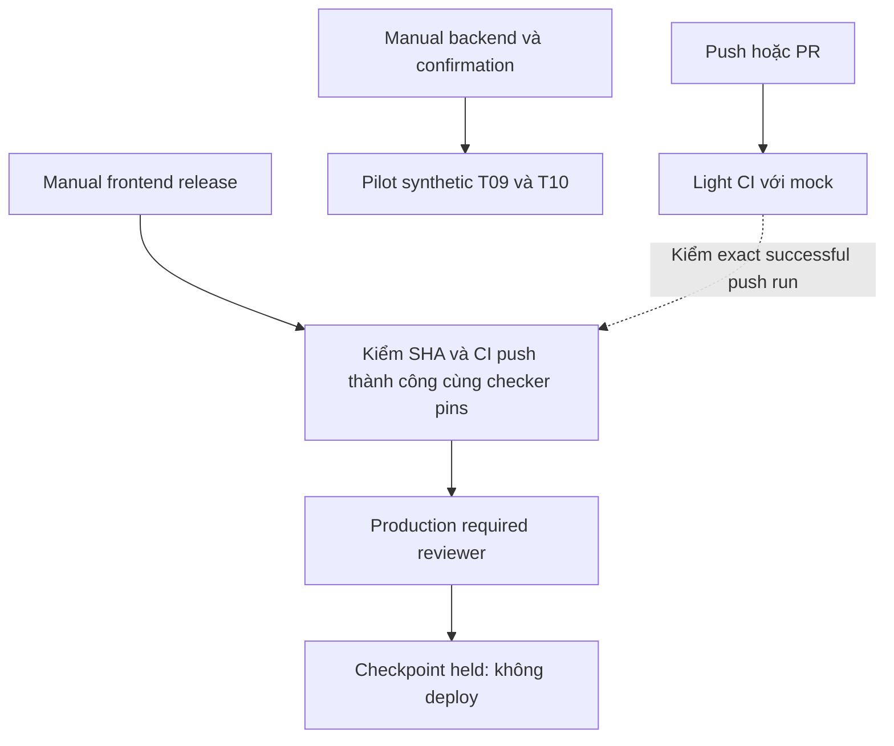

# CI/CD setup — checkpoint 17/10/2026

Phạm vi được owner giao: CI nhẹ tự động PR/push, backend synthetic manual, CD frontend Vercel có duyệt và giữ production. DB/Edge riêng. [Handoff](../workflow/tasks/project-ci-cd-setup-2026-10-17.md), [spec/plan](../../openspec/changes/setup-project-ci-cd/proposal.md).

## Hiện trạng bàn giao — CI PASS, backend FAIL, CD chờ duyệt

Nhánh triển khai `ci/project-pipeline-20261017` ở `0781f755737747fc8cc810ac5484b12d892013a4`. [CI30](https://github.com/nguyentronglinh045/pos-cafe/actions/runs/39026804330/attempts/1) đã **PASS đủ 11 bước** trên đúng commit: unit1.173, tooling566 + đúng1manualDeferred, Node104, browser preflight1, smoke44PASS+37applicabilityskip/81inventory, UIselftest23, UIaudit48PASS với6finding baseline sẵn có. Source preserved/core restored; peak trong vùng task978.341.888B. Scope light/mock không thay backend acceptance.

[Backend18](https://github.com/nguyentronglinh045/pos-cafe/actions/runs/39027568904/attempts/1) đã chạy thật trên cùng commit và **FAIL**. Bootstrap/Auth/API binding/source preservation đạt. T09 có 1 assertion PASS nhưng suite FAIL/exit1 vì 1 hook error, không có run error; T10 chưa chạy, tổng counts chưa xác định. Chẩn đoán hữu hạn: phase4 `read-fixture`, step13 `cleanup-read`, code17 generic `IMAGE_CLEANUP_STEP_FAILED`, SQLSTATE không xác định; catalog drift mask1, financial drift mask0, các nhóm Storage không có drift trong snapshot. Điều này xác định nhánh lỗi, chưa chứng minh root cause cụ thể bên trong cleanupReadFixture. Cleanup môi trường ngoài đạt, core pattern đã khôi phục.

[CD checkpoint mới](https://github.com/nguyentronglinh045/pos-cafe/actions/runs/39028263852) dùng workflow trên main `f9c566999c4367a5ca54a879fe3b06b5870f26f2`, kiểm exact source `0781f755737747fc8cc810ac5484b12d892013a4` và CI30/attempt1: **preflight PASS, approval WAITING_HUMAN**. Production16685477499 yêu cầu reviewer54500418, chỉ main và admin bypass=false. Tín hiệu `FRONTEND_RELEASE_PREFLIGHT_VALID_PRODUCTION_HELD` đã được đọc trong DOM job117383454382; job approval117383507170 còn waiting. Checkpoint cũ39021837504 đã cancelled vì source lỗi thời. Không approve/deploy; code production=false, chưa có lệnh hoặc token deploy Vercel.

**DEC-CICD-06 — 17/10/2026:** owner trả lời câu 0 của `call_801a8f97fddc4f58a5825cd0bbfe23e5`: “Chốt CI/CD; ghi backend FAIL, sửa fixture ở phiên phân quyền (khuyến nghị)”. Mốc bàn giao này xác nhận CI/CD đã cấu hình và chạy thật; giữ nguyên backend acceptance FAIL, chuyển việc điều tra/sửa cleanup fixture sang phiên phân quyền. Không giảm coverage, đổi baseline/ACL hoặc nhận backend PASS; chưa phát hành production.

| Gate | Trạng thái tại mốc bàn giao |
| --- | --- |
| CI light/mock exactsource0781f75 | PASS, CI30attempt1; đủ11phases, không thay backend scope |
| Backend manual workflow | Đã chạy thật, backend18FAIL; gate vẫn đỏ |
| T09 / T10 | T09suiteFAIL dù assertion1PASS; T10NOT_RUN; totalsUNKNOWN |
| Bảo toàn dữ liệu backend | Catalog drift mask1; financial mask0; Storage không drift trong snapshot; innercheckFAIL |
| Cleanup môi trường ngoài | true, cleanupFailurenull; core restored |
| CD negative control | PASS việc chặn CI FAIL, run39002739692 |
| CD exactsource0781f75 | PreflightPASS / WAITING_HUMAN, run39028263852; không deploy |
| Provider readback | 11:19–11:23UTC: Vercel Git skip exit0/canonicalrepo; Production/main-only/reviewer/no-admin-bypass |
| Full backend / TC-IDEM-087 / production | Chưa được nghiệm thu; giữ đầy đủ gates, không thay bằng light PASS |

Phiên phân quyền tiếp tục từ commit `0781f755737747fc8cc810ac5484b12d892013a4`, run backend18/attempt1 và các ordinals/masks ở trên. Cần xác định lỗi trong cleanupReadFixture, sửa khôi phục catalog đúng baseline và chạy lại toàn bộ T09/T10 trên source mới; không bỏ hook, đổi acceptance hoặc lấy assertion PASS thành suite PASS. Gate production vẫn cần đầy đủ backend và bước bật triển khai được duyệt. TC-IDEM-087 legacy chưa chạy, cần fixture riêng; pilot T09/T10 không phủ case này. Main cũ chưa CI riêng/branch protection, và database/Edge nằm ngoài CD, đúng phạm vi owner đã chọn.

Windows checkpoint11:09UTC: C199.800.643.584B/D100.739.907.584B còn trống. Artifactlocal53.153.629B logical, không phải allocation thực; không quy mọi biến động ổ đĩa cho task. Không tạo WSL/Docker Desktop hoặc cài dependencies mới trên Windows trong lượt setup. Backend filesystem18GiB/taskguard20GiB/reserve30GiB trên GitHub runner tạm; operating guards không là quota OS tổng quát. Archive actionlint ZIP đã xóa theo owner, thu hồi đo được2.482.176B; exe/hashproof vẫn giữ và đã dùng lint tiếp. Không xóa temp khác.

Hồ sơ này được freeze trước công bố. Nhánh đích `docs-ci-cd-20261017` chỉ được tạo sau khi hai reviewer độc lập APPROVE exact manifest và helper công bố; commit message của nhánh ghi manifest cùng hai approvals. Trạng thái công bố cuối được đối chiếu bằng [lịch sử commit của nhánh](https://github.com/nguyentronglinh045/pos-cafe/commits/docs-ci-cd-20261017) và receipt local `artifacts/project-ci-local/docs-published.json`, không tự nhận sự kiện sau freeze trong nội dung snapshot.

## Lịch sử các checkpoint trước — không phải hiện trạng

Candidate11 chỉ thêm chẩn đoán hữu hạn cho lỗi guard/process/backend setup, không thay assertion, coverage, timeout, retry, UI baseline hoặc resource limits. Cả hai reviewer APPROVE exact manifest `de1e9960b05498e49f0fbfa8b13965ef61ba4e1a927dd815a0150f3161b3f362`, 37 snapshot/live pairs và19 canonical pins,53/53 localPASS. Main policy vẫn pin checker5e86599; refresh lên checker mới cần exact tree review và successful run, chưa publish bản chuẩn bị.

Candidate12c được cả hai reviewer APPROVE và publish9261aa1: 55/55 local PASS/ba workflow lint PASS; thêm LimitCORE0/readback cùng safe owned/core/free facts, backend supervisor/loop numeric facts và sửa exact hai binary Supabase. Chưa kết luận core dumps gây thiếu đĩa hoặc companion gây refusal EXTRACT_NODE; archive mismatch là một lỗi prep độc lập đã chứng minh. CI8 đã canceled, backend3 đã chạy sau khi CI8 completed. Candidate13 đang sửa format đồng bộ/cấp phát lại trước mount; full CI cuối vẫn cần chạy fresh attempt trên exact final source, giữ mọi canceled/fail history.

Không có WSL/Docker Desktop/dependency mới trên Windows. C/D tại checkpoint local còn200.455.102.464/102.085.025.792B; số biến động không được quy toàn bộ cho task. Backend dùng filesystem18GiB/task20GiB trên runner GitHub tạm, light/backend được chạy tuần tự. Archive/tool/snapshot local còn giữ, chưa xóa.

## Lịch sử checkpoint ban đầu

Code công bố tại nhánh ci/project-pipeline-20261017, source đầu ed3272cc7500d011d6dd027f169e49cca948d24c. Main5156820 và hai evidence refs giữ nguyên. Chưa merge ứng dụng/phân quyền vào main. Cấu hình vercel Gitdeploymentfalse mới có trên nhánh CI, chưa nhận là đã khóa auto Production cho main.

[Light CI39000070099/attempt1](https://github.com/24tx810010-hcmute/pos-cafe/actions/runs/39000070099/attempts/1): install/buildPASS, unitFAIL, phần sau NOT_RUN. Source không đổi, peak owned395MiB. Không suy diễn actual CI PASS từ49 local tooling tests. Backend actual chưa chạy; manual dispatch cần definition ở default branch. CD HELD, chưa environment/admin/default-branch bootstrap. Không có deploy token hoặc executable Vercel deploy path trong revision này.

## Review độc lập

| Candidate | Reviewer CI/resources | Reviewer CD/source | Xử lý |
| --- | --- | --- | --- |
| candidate01,9dd986fd704bdac6f721b58fc451e0aa57221300648d613c7d440a0e18eadf2a | /root/review_push_package CHANGES_REQUESTED | /root/review_push_conditions CHANGES_REQUESTED | Hai npm configs; exact safe.directory; canonical Git pins; detector/fixture pins |
| candidate02,d573f0c286416e2258477a829e9022e16a91521076ff6088e1f5a6c36bfdcefa | APPROVE local+featurepublication | APPROVE CD/source/privacy/docs+featurepublication |17canonicalpins,25live/snapshot pairs,49PASS/0skip; không nhận actualCI/backend/admin/main/prod |
| candidate03,9a1544bee09b54bc24f28fd1a286bf6a5ff9e5f8b1d14db235d1e9cc1116c3fd | CHANGES_REQUESTED normative allowlist | Cùng finding normative allowlist trước final | Bổ sung finite diagnostic/numeric/sourcepaths vào CICD-03/testplan |
| candidate04,1cf3c76830a1d6ca7edc168360aed2d950945f987b34cedb2aea4eb2c4949466 | APPROVE feature publication | APPROVE feature publication |18codebytes unchanged03,26pairs/50PASS có reuse reason; actualCI/backend/main/admin/prod không nhận PASS |

Các finding correctness đều đã đóng trước công bố candidate02. Actual fail sau đó mở diagnosis riêng; giữ nguyên kết quả FAIL của run đầu và source binding. Candidate mới bổ sung diagnostic an toàn phải review lại trước push.

[Run39000470658/attempt1](https://github.com/24tx810010-hcmute/pos-cafe/actions/runs/39000470658/attempts/1), source9e788022dccbf7d98f7296f582115c02ed09894f: install/buildPASS, unit1172/1173PASS,1FAIL tại architectureBoundaries.test.ts, các phase sau NOT_RUN. Thêm ordinal assertion dạng số để định vị đúng case; không in raw failure. Static AST Windows chưa thấy violation nên chưa đoán rule/import. Existing GitHub Production chưa protected; guard phải chấp nhận tên Production theo semantics case-insensitive của GitHub, giữ nguyên environment/history.

Checkpoint sau DEC-CICD-04: canonical nguyentronglinh045/pos-cafe cùngID1263057386 đãownerchốt; candidate06 haiAPPROVE và source116bbb6331fdf6d5ecff796d5605f6f8ffeef74f đãpublish. ExistingProduction16685477499 đã requiredreviewernguyen54500418, preventselfreviewfalse, adminbypassfalse, custombranchmain duy nhất; APIreadback04:05:44UTC và guardPASS. Chưa actualapprovaljob hoặc frontenddeployment, chưa backendmanualrun/defaultbranchbootstrap.

Ngoài phiên này, main được cập nhật4a89cc3 và VercelGit tựProductionReadyGf8TritxT3TLC6gSQCp97JWyfjgP lúc03:59:30UTC do24tx610002-VoVanNgoc. Đây không phải thao tácdeploy củaagent; không revert/delete trêninitiative. Vercelconnectedrepo đãtựnewcanonical, nohooks; providerIgnoredBuildStep cònAutomatic. Chuẩn bị siết futureGitbuild bằng presetDon’tbuildanything(exit0), cộnggit.deploymentEnabledfalse ởbootstrapcandidate sau; không tuyên bố manual/API toànplatform bị khóa.

Saucandidate07 haiAPPROVE, providerhold đãsave/reload/readbackDon’tbuildanything/exit0; Gitfuturebuilds bịcancel, giữProductionReady hiệncó. ActualCI4source116bbb6: unit1173/1173PASS, tooling566/567PASS failgates.tool.test.ts. TestTC-IDEM-087/tool trongfile đó cầnreal syntheticDBwrite, nên được kêexactfile/fullName/sourcehash/manualcommand vào backend-onlymanifest theoownerheavybackendmanual. Lightgiữfull567discovery/566required/1manualDeferred vàkhôngdropassertions; legacycasestillNOT_RUN, khácpilotT09/T10. Fullreleaseacceptancekhônghạ. Đây làsửa phânloạiCI, khôngcoi manualcase làPASS.

Candidate09 sau sửaaggregateTODOđược cảhaiAPPROVE,publishc84d0af. ActualCI5run39001969113: unit1172/1173failfirstarchitectureassertion; sauNOT_RUN, khôngclaimpartitionđãactualPASS. Unit chạyserial đểgiảmcontention, giữtimeout/retry0/coverage vàtests. DiagnosticstripANSI/failedmessages tránhmisscode/falsepositive từpassedtesttitles. Mainngườikhác tiếp tục9ce20b4; đangchốt scopebootstrap/CIcho baselineoldmain vớiowner, khôngmergeapp.

## Đường đọc code cho owner

1. `.github/workflows/ci.yml` → `project-ci-launch.mjs`: nguồn kích hoạt, read-only token, Node/actions pins, systemd bounds.
2. `project-ci.mjs` → `project-ci-results.mjs`: Git/event/lock/fingerprint, private child env/output, đầy đủ phases và exact inventories, safe numeric report. Các guard failures dừng phần phụ thuộc.
3. `backend.yml` → `project-backend.mjs` → `permission-ci1-worker.mjs`: manual confirmation, cgroup/18GiB loop/isolation/source, safe D12 pilot proof; không full backend release acceptance.
4. `frontend-release.yml` → `project-release.mjs` + `ci/release-policy.json`: CI/source/checker pins, đúng reviewer/main-only/no-admin-bypass, production constfalse. Thiếu proof/quyền thì BLOCKED.

Walkthrough đã được cung cấp trong hồ sơ này; chưa có phản hồi owner xác nhận đã đọc/hiểu. Nghiệm thu và phát hành là hai trạng thái riêng.

Candidate13 SHA256e7d29bf38cfdb22111c7b2a6602578e9638774e30597fefb979730803e884085 được cả hai reviewer APPROVE và publish1015790;55localPASS/lint3. CI9 canceled có chủ đích trước backend4. Backend4 completedloop+source-tools rồi FAILnpm-images/INTAKE_REFUSED/cleanuptrue; lỗi allocation trước đã vượt qua trên runner thật, chưa pilotPASS.

Probe đủ378 exact-lock npm archives:195.942.868B tải bằng stream, mọi SRI verified/tar exit0;358 accepted,20 @types bị từ chối do named roots (node, react v18.3…). Không lưu archive/giải nén/cài trên Windows. Candidate14 bind ngoại lệ named root vào exact @types registry URL và version major/minor, đòi một root duy nhất; không nới traversal/link/device/expanded bound. Probe lại20 gói633.584B với parser mới:20accepted,0tar/SRI error. Thêm finite NPM_DOWNLOAD/INSPECT/CACHE diagnostics, không raw output. Cần review/publish và actual backend mới; full CI vẫn pending.

Candidate14 SHA256d04c113437df5ab98fcb7c1a0269115ba3476af60e9982fb3fbe9f7c8159cc11 haiAPPROVE/fresh56PASS/lint3, publish8e28b01. CI10cancelterminal rồi backend5run39005522371. Backend5 vượt npm intake/cache nhưng FAILdocker exit1, operationnull, cleanuptrue; chưa suy nguyên nhân registry/daemon/disk. Probe riêng12 pinned publicECR manifest bằng HTTP từWindows:12HTTP200/exactmanifestSHA/configSHA, khôngpull/downloadlayers/càiimage; không chứng minh runnerGitHub network/dockerPASS. Candidate15 chỉ thêm finite image operations/ordinal và phân loại Dockerstderr trongRAM thành enum, không xuất rawmessage/URL/args/secret.

Lịch chẩn đoán tiếp theo: lần publish15 để auto lightCI chạy đầy đủ trước, chờterminal rồi mới backendmanual cùngsource. Không chạy hai runtime đồng thời, không đổi retries/coverage/matrix/acceptance. Nếu source còn đổi thì fullCI cuối vẫn phải chạy lại sourcecuối; các FAIL/CANCELED giữ lịch sử.

## Metadata review và công bố tiếp theo

| Candidate / manifest SHA256 | CI/resources reviewer | CD/evidence reviewer | Source công bố |
| --- | --- | --- | --- |
| 13 / `e7d29bf38cfdb22111c7b2a6602578e9638774e30597fefb979730803e884085` | APPROVE | APPROVE | `1015790fcee8897f03f0e8b7abde28bfc745af0e` |
| 14 / `d04c113437df5ab98fcb7c1a0269115ba3476af60e9982fb3fbe9f7c8159cc11` | APPROVE | APPROVE | `8e28b01e147469b07a5d42f7154c102965abb7ef` |
| 15 / `19fb7b5075436d383e5877b130154035145d22df52888021b6ad4fde0022bead` | APPROVE | APPROVE | `893538ef8e6e923025cb9cc597c81ab510b37bfc` |

Reviewer lần lượt là `/root/review_push_package` và `/root/review_push_conditions`, chỉ review, không sửa hoặc deploy. Approval này cho feature publication và lịch thực thi tương ứng; không nhận actual backend, main policy refresh hay production release đã hoàn tất. Candidate15 có 57/57 local tests, 0 skip/fail, ba workflow lint PASS.

## Chẩn đoán CI11 và backend6

CI11 source893538e có đầy đủ unit1173/tooling566+1deferred/Node57 PASS, smoke dừng210.859ms vì free space dưới30GiB; không nhận UI hoặc smoke PASS. Ổ host giảm khoảng59,6GB trong khi owned chỉ712MB; đây là tăng ngoài vùng task đã đo, không được nhận operating cap5GiB đã bao trùm mọi ghi của kernel. Core pattern là pipe dù hard/softLimitCORE0. [Linux core(5)](https://man7.org/linux/man-pages/man5/core.5.html) xác nhận piped handlers không chịu RLIMIT_CORE; chưa trace để chứng minh toàn bộ59,6GB là core dumps.

Candidate16 tạm đổi kernel core_pattern sang core trên duy nhất VM GitHub-hosted tạm của job, vẫn LimitCORE0; controller đọc lại mỗi checkpoint và từ chối drift. Launcher dừng exact owned unit và xác minh inactive/collected cộng recursively empty/ENOENT cgroup trước khi khôi phục đúng bytes pattern cũ; lỗi đọc/stop hoặc còn descendants thì fail closed, không khôi phục pipe đang có browser sống. Job bị kill/cancel có thể không chạy finally, VM sẽ được GitHub hủy; không nhận đó là proof restoration PASS. Không sửa kernel/WSL/Docker trên Windows.

Thêm guard bảo thủ host free decrease5GiB, ngoài owned5GiB/reserve30GiB, không nhận polling guard là quota OS. Smoke dùng line+JSON private để lấy lỗi launch trước khi reporter JSON hoàn tất; public chỉ finite browser codes, không raw stderr/titles/stack. Giữ tests/coverage/matrix/timeouts/retry0/UI baseline. Canonical19pins được cập nhật; main vẫn pin checker5e cũ và chưa publish refresh.

Sau CI11terminal mới dispatch backend6. Backend6 vượt npm-images và12imagechecks, FAILedge-network-warm/GUARD_REFUSED/commandnull/ordinal12, cleanupfalse. Chưa đủ dữ liệu phân biệt cache guard và teardown step; không đoán sửa cache closure hoặc giảm acceptance. Đây là blocker backend tiếp theo, chưaT09/T10.

Candidate16 SHA25699224a39ca824d18afc2f3cbec6bb48c01ab1fc2a3de405d4cee5a9bfd9419fd được hai reviewer APPROVE;60/60 local tests, ba workflow lint PASS,19 canonical pins. Publish đúng5file thànhb10933b;CI12 tự chạy, chưa có kết quả cuối. Sau publication đang soạn diagnostic backend17 ở local: finite Edge cache reasons/known package ordinal/numeric version và cleanup failure riêng, chưa publish/chạy actual. Không nhận local61tests là CI12 source60tests hoặc backendPASS.

## CI12 và candidate17

CI12 trênb10933b xác nhận guard core mới chạy thật: kernelCorePipe0, host decrease698.421.248B/peakowned712.290.304B, khôngOOM/PIDevent, còn90.902.732.800B và sourcepreservedtrue. Launcher đã xuất fixed restoration signal sau unit/cgroup check và readback. Không nhận toàn bộ tăng59,6GB của CI11 đã có syscall proof root cause; chỉ ghi cơ chế bypass đã chặn và lượt mới không tái diễn growth đó. Smoke vẫn FAIL sau480.350ms vì test/command timeout; report chưa hoàn tất, chưa biết case/helper cụ thể. UI NOT_RUN.

Candidate17 thêm smoke-preflight: chạy lại đúng case có sẵn desktop/pos-cafe.spec.ts:119 với timeout/assertions/retry0 gốc. Preflight1case là diagnostic bổ sung, không thay matrix81/6projects/37applicabilityskips hoặc UIselftest23/audit48. PASS tổng đòi đủ11phases; subset không thể thành fullsmokePASS. Preflight FAIL dừng phần phụ thuộc và có report riêng để định vị nhanh. Public diagnostics chỉ thêm counts nguồn report, projectordinal1..6, source line/helper line nguyên dương<=1.000.000 và progress index/total<=10.000; progress chỉ observed diagnostic, không dùng để xác nhận pass/count acceptance. File path vẫn phải thuộc Git inventory/failed report, max32. Raw title/message/stack/private paths không export.

Candidate17 — backend diagnostics tại mốc backend6 FAIL — chỉ thêm finite EDGE_VOLUME/BUNDLE/CACHE_PROOF operations, cache failure enum, knownpackage ordinal và numericversion/copy; mọi root/type/version/pin/SRI/tarball/dependency/expanded-bound checks giữ nguyên. Cleanup failure được báo riêng để không che lỗi chính; unmount thất bại thì không detach loop còn mounted. Wrapper success độc lập đòi outercleanuptrue/cleanupFailurenull cùng COMPLETE và D12PASS. Fixture test chứng minh D12PASS giả không vượt qua teardownfalse; không là actualpilot evidence. Backend6 vẫnFAIL/cleanupfalse, T09/T10NOT_RUN. Main policy/CDpositive vẫn chờ actualfullCIgreen, productionheld.

Candidate17a manifest `39daff286df1900b12f75f67f799ab3b359bf2a05b13c77306d80f21e28da24a` được cả hai reviewer APPROVE exact7files/59pairs/19canonicalpins; fresh64/64localPASS và3workflowlintPASS. Full smoke cũng đọc safe structured report khi FAIL. Đã publish `b29a605fdbc1bf3f4f780b6951ecebaf59ba1984`, worktree CI sạch, auto CI13 đang chạy; backend7 sẽ dispatch sau CI13 terminal theo execution-order15. Chưa main policy refresh hoặc CDpositive/deploy.

## CI13 và chẩn đoán candidate18

CI13 exactb29a605 chạy preflight đúng1case: FAIL67.329ms vì TEST_TIMEOUT, có JSON report1unexpected, không raw message/stack export. Không có helperline/browserfailure category nên chưa xác định browser fixture, navigation hay application assertion. Full smoke/UI vẫn NOT_RUN. Tổng light vẫn FAIL, không hạ timeout/assertions/matrix để xanh. Host decrease696.561.664B, noOOM/PIDlimit, sourcepreserved/restorationtrue; không tái diễn tăng59GB ở lượt này.

Candidate18 chỉ bổ sung finite API categories BROWSER_CONTEXT/BROWSER_PAGE/PAGE_NAVIGATION/LOCATOR_ACTION/ASSERTION_VISIBLE/FIXTURE_SETUP/FIXTURE_TEARDOWN và số dòng/cột nguyên dương<=1.000.000 trong known failed source file. Chúng là observed diagnostics, không dùng thay acceptance counts, không xuất API args, title, message, stack, URL hoặc private path. Regression đi qua nested Playwright report và publicSummary, loại fake secrets/private paths và unknown source. Chưa sửa application hoặc test assertion. Backend7 đang chạy trênb29a605; chưa nhận actualpilotPASS.

## Backend7: kết quả thực và candidate18

Backend7 exactb29a605 completed loop/source-tools/npm-images, đủ12images. Primary failure EDGE_CACHE_PROOF/EDGE_CACHE_PIN tại packageordinal8 (@types/node), version22.5.4/copy0. Teardown riêng CLEANUP_UNMOUNT/umount exit32, cleanupfalse; không nhận D12/T09/T10 PASS hoặc teardown đã sạch.

Candidate18 giữ18pins cũ và thêm đúng @types/node22.5.4 đã thấy trên runner cùng undici-types6.19.8 thỏa dependency~6.19.2. Metadata chính thức4.835/1.731B, archive404.125/21.139B được stream/SHA512 SRI verified, không lưu archive/giải nén/cài trên Windows. Receipt2f0c842a4641461fb3c38d21e035157b324400b8c30b0b2e87aad062b0f97e9b. Đây là pin version cụ thể đã kiểm, không cho qua unknown version/peer copy/entry; metadata/SRI/tar/dependency/file/bound checks giữ nguyên. Cần actual Edge proof để biết toàn bộ closure đã khớp.

Bundle containers đổi sang Docker --rm để tự xóa container khi lệnh kết thúc, giữ named Deno volume cho offline proof; không prune/reset hoặc lazy/force unmount. Điều này xử lý một nguồn mount lifecycle còn giữ; chưa chứng minh root cause toàn bộ umount32 hoặc cleanup đã PASS. [Docker run](https://docs.docker.com/reference/cli/docker/container/run/#clean-up---rm) mô tả --rm; named volumes được giữ.

Resource gap được đóng trong source: backend dùng chung adapter core_pattern core/verifiedrestore với light trên duy nhất VM GitHub tạm, backend unit LimitCORE0, Docker default-ulimit core=0:0 và bundle explicit ulimit0. Worker supervisor/harness đọc lại hard+soft0 và regular core pattern. Adapter chỉ nhận exact owned light/ci1 unit; trước restore phải stop/inactive hoặc collected và recursively empty cgroup, giữ failclosed nếu không xác minh được. Không đổi WSL/kernel trên Windows; chưa nhận enforcement backend thật trước lượt mới. Regression từ chối arbitrary unit, piped pattern/nonzero limit, missing/duplicate daemon default ulimit. Các CPU/RAM/PID/fs/time/coverage/acceptance giữ nguyên.

Candidate18 bị hai reviewer CHANGES_REQUESTED trước publication vì Docker default-ulimit có thể bị từng container override. Candidate18a thêm actual /proc/<State.Pid>/limits cho đủ12runningservices với12PID riêng: hard/soft đều0, patternregular; missing/readerror/EACCES/nonzero/stopped/invalidPID/duplicatePID/incompleteinventory đều refuse. Envelope bắt buộc containersCoreDisabled=true, thiếu field cũng reject. Short-lived bundle chỉ claim explicitulimit configuration+regularkernelpattern, không giả vờ có running-process snapshot sau khi nó đã kết thúc. Chưa Linuxbackend readbackPASS trước lượt18a mới.

Candidate18a manifestc11382f1eb3ad6fc3982a6f79bfbdef7630198c7ab32ff60e42d4559524f7a82 được cả hai reviewer APPROVE exact12files/65pairs/23canonicalblobs/19pins, fresh67/67PASS/lint3. Finding18 actualcontainercore-readback đã đóng trước publication. Đã push543a3feeb5da7cda7cffab08eaedddc195356baa, worktree CI sạch; CI14 đang chạy, backend8 chỉ sau CI14terminal. Mainpolicy/CDpositive chưa được duyệt hoặc công bố; productionheld.

## Candidate19: smoke step reporter, optional metadata và teardown

CI14 actual543a3fe: unit1173/tooling566+1deferred/Node67 PASS; preflight FAIL67.741ms, ASSERTION_VISIBLE/TEST_TIMEOUT. Dòng119:1 từ reporter header là test declaration, chưa là vị trí assertion hoặc root cause UI. Candidate19 dùng custom observer reporter ngay trong project-ci-results.mjs đã có trong19trustedpins, giữline+JSONreporters. onStepEnd/onTestEnd chỉ xuất tối đa32records với fixed schema/ordinals/knownfile positive linecolumn<=1.000.000 và duration<=480.000ms; không onEnd/status override/test mutation. Marker private chỉ cung cấp observed diagnostics, không acceptance counts. Ưu tiên actual step location qua header. Rawtitle/message/stack/URL/args không export; chỉ finite code/ordinals. Regression kiểm loại secret/unknownpath/hostileordinal, cap32, observedfailure vẫnFAIL.

Ordinal maps: locators1landing-screen/2store-pairing-screen/3passcode-screen/4floor-page/5order-drawer/6submit-order-button; category1pw:api/2expect/3fixture/4hook/5test.step/6test.error; source1pos-cafe.spec.ts/2helpers.ts/3permission-ui-closeout.spec.ts/4demo-runbook.spec.ts. API1browserType.launch/2browser.newContext/3browserContext.newPage/4page.goto/5locator.click/6locator.fill/7toBeVisible/8toBeHidden/9browserContext.close/10browser.close/11page.waitForLoadState/12page.waitForURL. Ordinals chỉ là quan sát, không chứng minh test PASS.

Backend8 actual543a3fe đã vượt lỗi pin22.5.4 trước, rồi EDGE_CACHE_METADATA tại packageordinal11/bufferutil, chưa có facts chứng minh entries cụ thể. Optional-metadata-only là giả thuyết format cần kiểm ở lượt mới. Metadata official ws8.22.0 xác nhận bufferutil/utf-8-validate optional peers; node-gyp-build là dependency trong hai pin peer đã kê. Receipt2.473B/SHA19e46c25aee0f363b5ee023af66ac3800482c18741cc95f236ba1fe15f1db039.

Candidate19 khai báo metadataOnlyAllowed chỉ bufferutil4.1.0/utf-8-validate6.0.6/node-gyp-build4.8.4, pins đã có giữ nguyên. Chỉ đúng một registry.json regular/nonsymlink/bounded, exactname/version/SRI/tarball/dependencies mới được nhận; bytes được tính cap512MiB và contenthashed vào private cacheproof. Không tính metadataOnly vào observed installed packages; root thật vẫn phải installed, offline bundle/stack/T09/T10 vẫn bắt buộc. Requiredpackage thiếufiles, unknownentry/version, badmetadata/SRI/symlink vẫn reject. Parser không bỏ qua dữ liệu để tiết kiệm dung lượng.

Backend8 cleanup vẫnfalse/umount32, --rm chưa đủ để nhận teardownPASS; source không kết luận process giữ mount hoặc nestedmount là root cause. Candidate19 kiểm findmnt submounttree: top phải exactownedroot/loop, mọi target canonical trongroot, max4096; kiểmbackingfileexactlayout.image trước khi normal recursive unmount. Không kill hostPIDs hoặc force/lazy unmount/prune. Nếu mountbusy thì vẫnFAIL và khôngdetachmountedloop. Chỉ thêm finite UNMOUNT_BUSY/PERMISSION/NOT_MOUNTED, numeric nestedmountcount/entrycount/registrypresent để phân biệt lần sau. [umount manual](https://man7.org/linux/man-pages/man8/umount.8.html) xác nhận normal --recursive dừng khi chain thất bại. Actual backend pattern restore signal=true, nhưng chưa tới12service readback/T09/T10; không nhận core-container/Pilot PASS.

Candidate19 bị package reviewer CHANGES_REQUESTED trước publish: metadata-only files có thể làm totalfiles>0 dù root versiondir trống. Candidate19a thêm counter riêng chỉ tăng khi đọc installedfile của expectedroot, bắt buộc rootFiles>0; metadata không tăng counter. Regression rootdir trống+optionalregistry cóbytes phải reject. Không dùng optionalmetadata làm evidence root package đã installed.

Candidate19a manifest `497cc5d4fd968f4c7417e56797691ec2a6d1e7ac36a9031ede72b53370b44455` được `/root/review_push_package` và `/root/review_push_conditions` APPROVE exact9files/69pairs/23canonicalblobs/19trustedpins, fresh70/70 localPASS và3workflowlintPASS. Đã publish source `9cea1339256e821bd931e5eb559222c5260158bc` lúc2026-10-17T06:46:47.164Z; CI15/39011185000 attempt1 tự chạy. Backend9 chỉ dispatch sau CI15terminal trên cùngsource, không song song runtime nặng. Approval này không phải actualfullCI/backend/mainpolicy/CDpositive hoặc production release.

## CI15: đã định vị assertion, chưa kết luận lỗi ứng dụng

Source9cea133 CI15 completedFAIL: unit1173/tooling566+1deferred/Node70PASS; observer xác định actual failed step pos-cafe.spec.ts:122:52, locatorordinal1/landing-screen, categoryexpect/APItoBeVisible, duration62.511ms. Chưa có bằng chứng browser engine, devserver module hay runtime ứng dụng gây timeout. Không tự sửa src/ hoặc tăng timeout/bỏ assertion. Backend9 dispatch39011547838 sau CI15terminal, same9cea133. Mainpolicy/CDpositive vẫn chờ fullCIgreen.

Candidate20 local chỉ bật DEBUG=pw:browser,pw:webserver cho preflight/fullsmoke, bỏ trước UI; output vẫn private32MiB/command8min và public chỉ finitecodes có sẵn. Đây là chẩn đoán theo [Playwright CI](https://github.com/microsoft/playwright/blob/main/docs/src/ci.md), không bật PWDEBUG, không thay timeout/workers/assertions/retry/source/coverage/matrix. Chưa publish hoặc nhận runtime diagnostic mới trước lượt sau.

Candidate20 `5bbc62a375700d26f1fcbcf2d10294816e1f23f3ee962095447d37e14034db1c` được cả hai reviewer APPROVE exact2files/72pairs/23blobs/19pins, fresh70/70PASS/lint3. Đã push `f6b1bae7e110464e9c7d0d0418be1eaec3bcbb01` lúc2026-10-17T06:58:18.070Z; CI16/39011893697 đang chạy. Backend9 actual9cea133 chỉ completedloop/source-tools, image1 rate limit; cleanuptrue/core restoretrue không chứng minh cleanup sau Edge/containerstack. Backend10 sẽ chạy sau CI16terminal trên exactsource mới. Không đổi mainpolicy/CDpositive/production.

## CI16 và diagnostic trace21

CI16 sourcef6b1bae completedFAIL ở đúng landing-screen/toBeVisible122:52, duration63.735ms, không thêm browser/webserver finite cause. Unit1173/tool566+1deferred/Node70PASS; nguồn/restorationtrue, hostgrowth696.774.656B, fullsmoke/UI NOT_RUN. Backend10 dispatch39012189026 sauCI16terminal, same source. Không sửa ứng dụng khi chưa biết nguyên nhân.

Diagnostic21 local thêm trace retain-on-failure cho1preflight, parser console/pageError/network hữu hạn từZIP owned/canonical<=32MiB; unzip có sẵn -Z1/-p không extract, decoded16MiB/10000events/child10s và env riêng. Không giữ raw trace ngoài VM, không đổi tests/timeouts/retry/coverage/matrix; missing/invalid trace vẫnFAIL. ZIPfixture thực kiểm interoperability, không nhận actualbrowser/appPASS. File/dòng từ browser là generated served-module observation, chưa map TSX gốc.

Backend10 sourcef6b1bae completedloop/source-tools/npm-images/edge-network-warm/stop-prefetch/private-namespaces, đủ12images. Warm-cache proof thực đã qua manifest20pins/required root installed; chưa có exported optional-metadata count nên chỉ nhận stage proof, không dựng counts. Failoffline-edge/unshare78/operationnull, cleanuptrue/cleanupFailurenull/restorationtrue. Chưa chạy12runningservice core readback/T09/T10. Diagnostic21 thêm exact-bound private innerfailure receipt, finite operations và primary/daemoncleanup riêng; parent từ chối raw/unknown/mismatch và không có record thì giữ lỗi gốc. Không đổi actual FAIL thành PASS hoặc coi cleanuptrue là pilotPASS.

Candidate21 manifest `dda0b7597b084a4d9d39fd5fc46ce8310f7451516b88b4787e107baa3e2eea2b` được cả hai reviewer APPROVE exact6files/75pairs/23canonicalblobs/19pins, fresh75/75localPASS/lint3. Publish `71a9ebe7fcd349370dd8048adfd36e71b6c88476` lúc2026-10-17T07:14:58.087Z; CI17/39012942720 attempt1 đang chạy. Backend11 chỉ sau CI17terminal, same source. Docs draft21 riêng9files/162.190B/tree80574ee2dce4dc8886348060806471e7e4173b10 kiểm105relativefilelinks/0missing; externalURL/headingfragments không được nhận đã kiểm. Chưa finaldocsreview/publish, mainpolicy/CDpositive/deploy.

CI17 source71a9ebe completedFAIL, preflight5.640ms/TRACE_UNAVAILABLE; unit1173/tool566+1defer/Node75PASS, fullsmoke/UI NOT_RUN. Chưa biết trace path/ZIP/format refusal; diagnostic22 local chỉ thêm finite reasons/counters/metadata/IO, không nới reader. Backend11 dispatch39013231594 sauCI17terminal, same71a9ebe. Không sửa src, mainpolicy hoặc CDpositive/deploy.

Backend11 source71a9ebe FAIL OFFLINE_SUPERVISOR/COMMAND_FAILED/exit1, isolatedFailureSeen1/cleanupFailed0; đủ12images/warm-cache/private-namespaces, outercleanuptrue/restorationtrue, chưaT09/T10. Candidate22 đổi5liveproperty queries từ root-private systemctl transport sang exact readonly ordinary systembus get-property trong worker+harness; PIDpeer mechanism là suy luận có source255, chưa rawstderr/syscallproof hoặc actualnewtransportPASS. Không giảmnamespace/resource/acceptance. Trace22 vẫn chỉ finite refusaldiagnostics.

Candidate22 manifest `33384f6f4a3e569663c0e11763fa4e7cd454d7cda753a7a264d88afd5abdbe29` được cả hai reviewer APPROVE đúng6delta/78snapshotfiles/23canonicalblobs/19pins, fresh77/77localPASS/0skip và3workflowlintPASS. Publish `05df4c0fecfaf4e1eeba2cc17c5043968947749e` lúc2026-10-17T07:34:00.903Z; CI18/39014126026 attempt1 đang chạy. Backend12 chỉ dispatch sauCI18terminal trên cùngsource, không chạy đồng thời. Mainpolicy/CDpositive và finaldocs chưa review/publish; productionheld.

CI18 completedFAIL preflight3.368ms, 77NodePASS, 1173unitPASS và566toolingPASS+1deferred. Trace refusal8/parseLine112, ZIP đọc được1attachment/7entries/3selected,57.147Bcompressed/579.600Bdecoded. Backend12 dispatch39014323159 sauCI18terminal trên05df4c0. Không xem5ms observed expectstep là bằng chứng nguyên nhân ứng dụng.

Trace23 local sửa lỗi reader có counterexample cụ thể: [Playwright1.60 testTracing.ts:216](https://github.com/microsoft/playwright/blob/v1.60.0/packages/playwright/src/worker/testTracing.ts#L216) ghi test.trace bằng join-newline nhưng không thêm newline cuối. Reader22 unzip-p nhiều member nối thẳng có thể tạo haiJSON liền nhau. CRC-valid ZIP fixture test.trace khôngfinalLF + librarytrace/network tái hiện parseFAIL với readercũ; reader23 stream riêng từngmember, chèn newline boundary, giữ aggregate16MiB/10000events và tổng thời gian đọc10s, khôngextract/rawwrite/export. Đây là lỗi tooling đã tái hiện, phù hợp failureparse thực nhưng chưa được kiểm lại trên runner; chưa kết luận root cause landing-screen. Malformed JSON trongmember vẫn reject; aggregateoverflow/timebound vẫn giữ. Chưa thay src/tests ứng dụng/acceptance.

Backend12 completedFAIL PILOT_HARNESS/COMMAND_FAILED/node exit1, isolatedFailureSeen1/cleanupFailed0; cleanuptrue/restorationtrue. Worker source05df4c0 tại scripts/permission-ci1-worker.mjs:585–601 thực thi offlinebundle/cacheproof, STACK_ENVELOPE (bao gồm12servicecorechecks) vàEdgepublic/gateway health trước đặtPILOT_HARNESS. Đây là bằng chứng codepath đã vượtguard đó, chưa là public numeric/readback snapshot riêng hoặc T09/T10 suitePASS. Launcher failurepath hiện chỉ in finiteworkerfailure, bỏ qua public-evidence nếu harness tạoFAIL; cần safeFAILprojection giữbinding/status để lấy actualsuitecounts, không nhậncleanuptrue làpilotPASS.

Candidate23 `a124a4c68ba8b5674fb621e5bd781e806e465146e211ebbc1e97adf2a6c22e9b` được cảhai reviewerAPPROVE exact3code delta/81pairs/23blobs/19pins/fresh79PASS/lint3. Chỉ saubackend12terminal mới push `ca76b78fde8c5f540eb5384ffd3e84881359fe85` lúc2026-10-17T07:44:35.020Z; CI19/39014781965 đangchạy. Khôngmainpolicy/CDpositive/finaldocs publication/deploy.

Backend24 local thêm failure-only D12 projection: exactworkerERROR/PILOT_HARNESS/nodeexit1/6completedstages/cleanuptrue phải có exportednonPASS strictD12 và exactrepository/run/attempt/source/workflow mới công bố safeJSON/Markdown. Successgate/exitFAIL giữ nguyên; missing/tampered/overallPASS chỉ fixedunavailable. Không suy từ actualbackend12 rằng T09/T10 chắc chắn chạy; projection cần manualrun mới để biết report có tồn tại và counts/checks nào. SauCI19terminal có thể công bố24, rồi fullCI source24terminal trước manualbackend sameSHA; không cần lặpbackend trên23 chỉ thaytrace. Chưapublish/mainpolicy/CDpositive/deploy.

CI19 ca76b78 completedFAIL: trace23 reader đã actualPASS readability/contextguard,0page/consoleerror/warning/HTTP4xx/5xx. PreflightvẫnFAIL landing-screen122:52; không có bằng chứng rootcauseJSapp. Unit1173/tool566+1defer/Node79PASS, source/restorationtrue, fullsmoke/UI NOT_RUN. Không đổi assertion hoặc tăngtimeout.

Candidate24 manifest `0249dd3a683b34580c5bb9f10e50e51588fbb222c628f16e82d0c61d497dd634` haiAPPROVE/82frozensnapshots/23blobs/19unchangedpins/fresh80PASS/lint3. Actualdelta đúng2files project-backend.mjs vàpermission-ci1-worker.test.mjs; policybyte-identical23. CI19metadata đãđổi saufreeze, snapshotgiữtrạngtháitheothờiđiểm. SauCI19terminal push `89f4b2502e4df713dfc56fbb39f775cd36e06b64` lúc2026-10-17T07:50:11.077Z; CI20/39015134195 đangchạy, chưaactualmanualtrên24.

Diagnostic25 local dùng tracev8 frame-snapshot NodeSnapshot để đếm đúng8fixedscreens vàDIV#root, resolvepostorderreferences trongsamepage/frame. Chỉ mainframe URLlocalhost5175/root; visited<=100000/depth<=256/count<=1000000. Publiclastsnapshot facts chỉ có mainframescount/completeness/mask/landingcount/rootcount; unresolved/malformed/reference/depth/size không được nhận0hoặcPASS màcomplete0 và bỏcounts. Counts làDOMobservation, không đovisibility hoặc thayacceptance. Thêm6fixedselector/protocolcodes vàHTTP2xxcount, khôngHTML/text/attributes/URLs/pageIDs/errorstrings hoặc known-userdata. ChưaactualDOMfacts trướcpublication/runmới. Có thểbatch25sauCI20terminal rồiCI21terminal trướcmanual13same25, backend24reportingđượcgiữ; không lặplượtbackendchỉđểđổiobservability.

CI20 exact89f4b25 completedFAILpreflight5.683ms, unit1173/tool566+1defer/Node80PASS. Trace readable/noJSorHTTPerror như19; sourcepreserved/restorationtrue, noOOM/PIDevents; fullsmoke/UI NOT_RUN. Chưamanualtrên24 nên failureD12projection chưaactualverified; dựkiếnbatch25rồimanualsamefinalsource,khôngsong song hoặcnhậnproofcũlàPASSmới.

Review25 CHANGES_REQUESTED trướcpublication: attrs phải đúngstringmapv8, không nhận malformedattr thànhcomplete1/zerocount; mainframe rờiURLscope/invalidURL phải invalidateoldcounts vàcomplete0. 25a thêmstringvalueguard,25b thêmlastsnapshotinvalidations vàregression external/path/invalidURL+unknownattrtypes/100001nodes. Khôngpublish25/25a; freshfinalcandidate sẽreviewlạicảhai. Khôngtái dùng82PASScũ làmproofsource25b.

Final25b manifest `5a9e0ef9f0a6368350c3c2a3a368c8043ee63de62c599888e4ec9636fa6dbeb3` được cảhaiAPPROVE exact3delta/85pairs/23blobs/19pins/fresh82PASS/lint3. Publish `1c72ed6f6c8d388f97e6babf4fcd06cc56fbe0b2` lúc2026-10-17T07:59:16.170Z sauCI20terminal, khôngactivebackend. CI21 sẽtựchạy; manual13chỉsauCI21terminalsameSHA. Freshremote mainvẫnf3cea61. Khôngmainpolicy/CDpositive/finaldocs/deploy.

CI21 exact1c72ed6 completedFAIL, DOMdiagnostic25b actualv8 complete1/landing1/root1/mask1,0JSerrors/HTTPerrors. Không tựsửaapp vìchưabiếtvisibility/matchercause. Source Playwright1.60 matcherHint/frames cho biết expectlog nhắc “with timeout” dù chưa timeout; regex TEST_TIMEOUT cũ matching “timeout” là falsepositive có thể xảyra, không nhận nhãn cũ làm bằng chứng rootcause. Diagnostic26 tách configuredtesttimeout/resultstatus/duration vàexactFrame.expect(landing,to.be.visible) before/after result booleans/knownreceivedordinal/errornameordinal/duration. Không xuấtselector/args/log/callID hoặc arbitraryreceivedvalue; chỉfixednumerics, giữ acceptanceFAIL/timeouts.

Manual13 chạy sauCI21terminal cùng1c72ed6, completedFAILloop/source-tools/image1rate-limit, cleanuptrue/restorationtrue; T09/T10 chưa cóevidencemới.26 local thêm boundedbackoff chỉexactDOCKER_REGISTRY_RATE_LIMIT khi pull exactECRSupabasedigest: tốiđa3attempts, waits10s/30s, guardtrước/sauwait, cùngdigest/platform, hếtlượt vẫnFAIL. Auth/network/disk/unknownkhôngretry; testretry vẫn0 vàCPU/RAM/PID/fs/runtime/coveragegiữnguyên. KhôngAWSlogin/quyềnmới. Ngân sách filesystem18GiB/task20/reserve30giữ; worst repeatednetworkdownload cóthểtới~7,5GB/tool+images nhưngkhôngtăngretainedcap, phải báo LỚNHƠN1GB trướcmanualmới. ChưaactualbackoffhoặcFrameexpectfacts trướcpublish/run26.

Review26 CHANGES_REQUESTED trướcpublication: trace after.result nhận protocolSerializedValue, khôngrawJS. FrameDispatcher.expect serializeResult string thành{s:'visible'}/{s:'hidden'};26a narrowdecode đúngexactsinglekey s và v:undefined, mọiother/raw/malformedvaluegiữordinal3 hoặcmissing0, khôngdeserializearbitrarydata. Thêmregression đúngprotocolshapes/privateunknown/missing;26 chưa publish, fresh26a sẽreviewlại.

Final26a manifest `cc2f369415e6c004162488c629096639e4a92ca60c70b31de160edecd23fc125` được cảhaiAPPROVE đúng5delta/88pairs/23blobs/19pins/fresh84PASS/lint3. Publish `470ea50f01b64ebb5ff8c7e51390c607be5196b0` lúc2026-10-17T08:13:56.696Z sauCI21/backend13terminal. CI22tựchạy; manual14chỉsauCI22terminalsameSHA. Khôngmainpolicy/CDpositive/finaldocs publication/deploy.

CI22 actual470ea50 completedFAIL nhưngloạiđượccáchdiễngiải“visibilitytimeout”: testtimeout60000ms/resultfailed1790ms, exactFrame.expecttimeout5000ms/matchesfalse/receivedmissing/Expecterror/duration5ms vàkhôngtimedOutfield. LastDOMcomplete1/landing1/root1/212HTTP2xx/noJSorHTTPerrors. [Serverframes.expectcatch](https://github.com/microsoft/playwright/blob/v1.60.0/packages/playwright-core/src/server/frames.ts#L1374) cóthểtrảmatchesfalse/missingreceivedkhibắtinfraexceptiontrướckếtquảintermediate; đây làsuyluận từshape/source, chưa chứngminhTargetclosed/crash hoặcCSSvisibility. Khôngsửaapp, khôngbỏassertion.

Manual14/39016844933dispatch sauCI22terminal, same470ea50; đãbáoLỚNHƠN1GB downloadexpected2,5–3,5GB/worst~7,5GB retries, fs18/task20/reserve30 trênGitHub, khôngWindowsruntime. Protocol27local thêmDEBUGpw:protocol CHỈsmoke-preflight; khôiphụcpw:browser,pw:webserver trướcmatrixfull, bỏDEBUGtrướcUI. Outputvẫnprivate32MiB/phase8min; publicchỉfiniteBROWSER_RENDERER_CRASH từInspector.targetCrashed/Pagecrashed/Receivedsignal6or11, khôngrawCDP/DOM/header/body/URL/secret. NormalTarget.detachedFromTargetkhôngcrashcode. Chưaactualprotocolcrashproof;khôngcoiđâylàfixcrashhayPASS.

Checkpointdisk: artifactsproject-ci-local5343files/35.865.111Blogical,0compressed/sparse. ChưađoNTFSclusterallocation/hardlinkdedup; khôngquytoànbộDfreevariationcho task. Khônglocaldependency/WSL/DockerDesktopinstall, chưaxóaarchive/evidence.

Review27 CHANGES_REQUESTED trướcpublication: regexRECVcũcóthểnuốtouterbracevàmatchnestedresponse.methodthànhcrash.27a anchor actualdebugnamespaceởđầudòng/trướcfirstJSONbrace, prefixsauRECVkhôngchứa'{', nênchỉnhậnoutereventmethod; namespacebrowser/api cũngkhôngmatchresponsebody. Thêmnegative nestedmethod/SEND/quotedbody/pw:api-or-browserwordsinbody. Khôngpublish27; fresh27a cầnreviewlại.

## Checkpoint candidate27a và backend14

Candidate27 ban đầu bị cả hai reviewer CHANGES_REQUESTED vì có thể nhận nhầm nested CDP response thành renderer crash; chưa publish. Candidate27a SHA256 `3006d97ce2b6bc124f3c989612130f2821827a74e83ad43fc4ef09e0b1f7f60a` đã được cả hai reviewer APPROVE, 85/85 local tests và ba workflow lint PASS. Regex giới hạn namespace trước JSON và top-level RECV event; regression chặn nested response, SEND và nội dung giả logger. Đã publish đúng bốn file tại `07c73847f836400a73ad800e744f2f19576cb735`; [CI23 attempt1](https://github.com/nguyentronglinh045/pos-cafe/actions/runs/39017387994/attempts/1) tự chạy từ push, hiện đang chạy. Protocol debug chỉ trong preflight, raw output private/bounded; chưa chứng minh crash thật.

[Backend14](https://github.com/nguyentronglinh045/pos-cafe/actions/runs/39016844933) trên source470ea50 đã terminal FAIL: IMAGE_PULL/imageOrdinal1/DOCKER_REGISTRY_RATE_LIMIT/imagePullAttempt3; cả ba lần có chờ vẫn bị giới hạn. Chỉ hoàn tất loop/source-tools; pilot chưa chạy. Cleanup=true, cleanupFailure=null, core-pattern restored được quan sát. Không nhận backoff là đã khắc phục quota hoặc D12 projection đã chạy thật.

## Bản chẩn đoán sau CI23

CI23 source07c7384 / run39017387994 attempt1 đã terminal FAIL. Build, unit1173/1173, tooling566/566+1manualDeferred, Node85/85 và browser install/discovery PASS. Preflight FAIL4.289s; test result1.599s, failed step7ms, exact Frame.expect5ms/matchesfalse/receivedmissing. Có BROWSER_RENDERER_CRASH trong log phase; chưa có thứ tự trước/sau failed step nên chưa chứng minh crash gây assertion. Trace DOM landing/root1, HTTP2xx212, 0 page/console/HTTPerrors. Generic TYPE_ERROR/REFERENCE_ERROR/TEST_TIMEOUT bị nhiễu bởi mã nguồn trong CDP debug; không dùng làm bằng chứng lỗi app. Source preserved/core-pattern restored=true; host decrease724.267.008B, ownedpeak738.914.304B, free90.884.141.056B; không thấy memcg OOM/PID event, không suy rộng thành loại trừ mọi native crash. Full smoke/UI vẫn NOT_RUN.

Bản chẩn đoán28 local giữ nguyên ứng dụng/assertions/matrix/retry0. Sau preflight FAIL, chỉ chạy static same-binary control khi cgroup.procs chỉ còn controller và nr_descendants=0; nếu chưa sạch thì skippedordinal1, không gán kết quả nhầm. Control không tải app/network/trace, 15s work deadline cộng tối đa5s kill grace, capture32KiB private. Stages1import/2launch/3context/4page/5setContent/6count/7isVisible/8expect/9complete; booleans/crashsignal riêng, không nâng phase thành PASS. Static PASS chưa chứng minh app có lỗi. Protocol event chỉ top-level RECV, xuất Inspector/Target flags, bounded Target status/errorCode, signal4/5/6/11 và thứ tự trước/sau failed-step; bỏ payload CDP khỏi generic failure scan. Chưa publish28/chưa actualcontrol.

## Candidate28 đã công bố và cleanup được owner cho phép

Candidate28 manifest `e96d5be9b1e2aba0bd9765fe0155b808a67d1ccfc31225d33792b5e3b7ed61e1` được cả hai reviewer APPROVE publication đúng bốn file; publish1e6b000, actual CI24 đang chạy. Không nhận đây là approval main policy/finaldocs/deploy.

Owner hỏi archive còn tận dụng không, nếu không thì xóa. ZIP actionlint chỉ dùng tải/giải nén ban đầu, exe hiện tại vẫn dùng được; đã xóa đúng archive lúc08:37:35UTC sau xác minh absolute path/SHA256/2.479.065B logical/regular non-reparse/1hardlink và process đã nhả. FileStandardInfo AllocationSize=2.482.176B; D free100.819.333.120→100.821.815.296B, thu hồi đo được2.482.176B. Exe6.432.768B và hash/proof vẫn giữ; không xóa artifact/evidence khác. C còn199.354.699.776B.

## CI24 và sửa định dạng diagnostic29

[CI24 run39018032282/attempt1](https://github.com/nguyentronglinh045/pos-cafe/actions/runs/39018032282/attempts/1), source1e6b000, terminal FAIL: build,unit1173,tooling566+1manualDeferred,Node88, browser/discovery PASS; preflight21.994s gồm diagnostic. Test result2.707s/step7ms/exactexpect3ms, DOMlanding/root1 và0JS/HTTPerrors. Static control bị dừng, browserProbeCommandCompleted0, chưa có finalrecord/stage; không nhận basic runtime PASS/FAIL từ đó. Core restore/source preserved=true. Ownedpeak739.127.296B, hostdecrease724.738.048B/còn90.883.690.496B, OOM/PID event0. Fullsmoke/UI NOT_RUN.

Candidate29 sửa lỗi parser đã tái hiện: Playwright1.60 helper.debugProtocolLogger dùng debug formatter có carriage return ở ranh giới line reporter; colored formatter thêm +0ms ngoài JSON. Gọi chính bundleddebug của dependency1.60 sẵn có trên Windows với synthetic SEND/Inspector event đã chứng minh bản28 còn TypeError/ReferenceError/Timeout giả và bỏ sót coloredcrash. Bản29 chuẩn hóa CR/LF và chỉ bỏ finite debug-duration suffix; before/after synthetic receipts giữ tại artifacts/project-ci-local/debug-format-29-{before,after}.json, không phải actual app logs. Primarysources: [helper.ts](https://github.com/microsoft/playwright/blob/v1.60.0/packages/playwright-core/src/server/helper.ts#L75), [debugLogger.ts](https://github.com/microsoft/playwright/blob/v1.60.0/packages/utils/debugLogger.ts#L49). Không nhận CI24 thiếucrashcode là khôngcrash.

Runtime control29 phát progress stages1..9 trước mỗi await, một crashmarker và failure-nameordinal1Error/2TimeoutError/3TypeError/4ReferenceError. Khi timeout/cleanup hang vẫn chỉ có partial stage, Complete/Cleanup giữ unknown nếu khôngfinalrecord. Parser đòi progress liên tiếp, <=9, khôngduplicate/unknownmarkers, finalstage khớp. Parent chỉ thêm probe TimedOut/DescendantsRemaining, guard ngay sau probe; probe không ghi đè primaryfacts/FAIL. Chưa đổi browser/app/assertion/coverage/matrix/timeout/retry hoặc resourcecap. Chưa publish29/chưa actualpartialprogress.

## CI25 runtime failure và candidate30

Candidate29 đã được hai reviewer APPROVE manifest58cc3b84647a4cba03c9d82a7b8a7f5dc3d8b5ca7874e090aa73990779dac483 và publish `ee29664bc28a0ee71fc2816883d63d02209fbf5d`. [CI25 run39018709247 attempt1](https://github.com/nguyentronglinh045/pos-cafe/actions/runs/39018709247/attempts/1) terminal FAIL: build, unit1173, tooling566+1manualDeferred, Node90, browser/discovery PASS. Primary preflight FAIL22.641s gồm control; test2.979s/expect2ms. Inspector crash quan sát trước failed-step (order1). Static HTML control tới stage6 locator.count rồi page crash1, timeout1, không finalrecord nên Complete/Cleanup unknown; sau dừng không còn descendants. Đây là basic-runtime failure không tải app, chưa chứng minh root cause của native crash. Trace lần này không có complete main-frame snapshot, không tái dùng DOM counts cũ. Source/core restore=true; ownedpeak738.910.208B, hostdecrease723.603.456B/còn90.883.731.456B, OOM/PIDevents0. Fullsmoke/UI NOT_RUN. Generic Type/Reference/Timeout vẫn không dùng kết luận app lỗi.

Candidate30 chọn full Chromium/new headless của đúng Playwright1.60.0/Chrome148.0.7778.96 làm CI runtime thay headless shell đã crash. Browser install --no-shell, playwright.config.ts use.channel=chromium khi CI=true, hai UI-audit launch và static control dùng cùng channel. Local mặc định giữ nguyên. Không đổi test inventory, assertions, six projects, retry0, coverage90, timeouts, detector, baseline hay ứng dụng. Đây là phương án sửa môi trường cần actual CI mới; chưa nhận mode mới đã chạy/PASS. [Playwright browser mode documentation](https://playwright.dev/docs/browsers#chromium-new-headless-mode).

LỚN HƠN 1 GB: trước chạy CI mới đã thông báo toàn light peak dự trù1,3–2,5GB. Đọc HEAD+1MiB ZIPtail chính thức chỉ vàoRAM xác định archive183.945.705B, expandedlogical393.407.709B/308entries, archive+extract577.353.414B; cộng baselineowned~739MB và khoảng trống cho outputs. Cài duy nhất trên GitHub RUNNER_TEMP/pos-light-*/browsers; Windows không cài browser/WSL/Docker. C/D trước lượt này199.378.669.568/100.823.846.912B. Light vẫncap5GiB/reserve30GiB, CPU300%/RAM8GiB/swap0/PIDs1024/25min; task20GiB. Metadata ZIP không chứng minh binary đã cài hoặc hoạt động.

Backend mirror30: [pinned Supabase CLI2.117 source](https://github.com/supabase/cli/blob/v2.117.0/apps/cli-go/internal/utils/docker.go#L229) có ECR→GHCR mirrors. Probe anonymous Windows chỉ manifest12/12 HTTP200, exact manifest SHA/config đều khớp; receipt bind inventorySHA256d65b0667a030ffa08ee774048f0365053f931afaadbf029bfa66cd7a30f2cec6. Không tải layer/image/install, token chỉ RAM. Worker sau đúng ba ECR rate-only failures/backoff10s,30s mới guard và pull GHCR một lần cùng repository-suffix/@manifestSHA/linuxamd64. Không fallback auth/network/disk/unknown/guard, không đổi version/tag/digest/credentials. Return pulled immutable reference để tag lại canonical originalref, giữ Config.Id/linux/amd64 inspect. Tổng tối đa4pulls mỗi image, không lần5; mirror error giữ FAIL. Failure imagePullAttempt1..4/imageRegistryOrdinal1ECR/2GHCR; tests/business acceptance không retry. Dự trù lần backend sau: tải thường2,5–3,5GB, worst~10GB nếu lặp tải; filesystem18GiB/task20GiB/reserve30GiB không đổi, không thêm stack/runtime. Actual GHCR pull/pilot chưa kiểm.

Candidate30 chưa publish, reviewer package CHANGES_REQUESTED vì manifest thiếu explicit snapshot/blob rows cho playwright.config.ts và ui-audit/run.mjs. Candidate30a bổ sung đúng hai code rows; toàn bộ executable bytes giữ nguyên, chạy fresh91tests/lint3 và đối chiếu đầy đủ sáu delta/19pins trước review lại.

## Candidate30a công bố

Candidate30a manifest `d68be2cc541a13355fba71886656496ebefe1126dbce292f48ae589c50120aa2` đã được cả hai reviewer APPROVE feature publication sau sửa thiếu snapshot. Có103snapshot/live pairs,25Gitblobs,19pins; fresh91/91local PASS và lint3 PASS. Publish đúng sáu file tại `7d6e269ef7751622beefe9bb9e4ca60adf248bd9`. [CI26 attempt1](https://github.com/nguyentronglinh045/pos-cafe/actions/runs/39019407444/attempts/1) tự chạy từ push, đang chạy; chưa actual new-runtime PASS. Main vẫnf3cea61/policy pin5e86599, chưa positiveCD, backend mới chưa dispatch cho đến CI26terminal.

## CI26 và controlled environment comparison31

[CI26 run39019407444/attempt1](https://github.com/nguyentronglinh045/pos-cafe/actions/runs/39019407444/attempts/1) source7d6e269 đã terminal FAIL dù đã đổi cùng-version full Chromium. Build,unit1173,tooling566+1manualDeferred,Node91, browser/discovery PASS. Primary expect24ms/test1.977s; Inspector crash trước failedstep. Staticcontrol fullChromium vẫn crash tại stage6 locator.count, timeout15s/no finalrecord, sau dừng không còn descendants. DOMsnapshotcomplete1/landing1/root1/HTTP2xx212/0JSorHTTPerrors. Ownedpeak965.939.200B, hostdecrease846.757.888B/free90.679.619.584B, source/core restoretrue và OOM/PIDevents0. Đổi browsermode chưa sửa được lỗi. Không sửaapp/baseline hay nhận fullsmoke/UI PASS.

[Backend15 run39019898992](https://github.com/nguyentronglinh045/pos-cafe/actions/runs/39019898992) manual đang chạy đúng7d6e269 sau CI26terminal. Đây là lần đầu source có GHCR fallback; chưa có kết quả actual pull/pilot hoặc transport nào đã dùng. Không suy metadata12PASS thành runnerPASS.

Candidate31 local chuyển riêng light service từ root mặc định systemd-run sang numeric UID của caller đang sở hữu checkout. UID phải safeinteger1..2147483647 và bằng stat.uid checkout; launcher và controller kiểm riêng, không root fallback. Chỉ service child User=UID; privileged supervisor/core-pattern write/stop/empty-cgroup/restore vẫn bên ngoài qua sudo như cũ. CPU/RAM/swap/PID/time/core/disk limits và env allowlist giữ nguyên; backend vẫn có supervisor riêng, không áp non-root lightguard vào backend. Đây là controlled environment comparison/giảm quyền, chưa chứng minh root gây crash hoặc non-root sẽ PASS. Không thêm runtime/dependency/distro.

Nếu preflight vẫn FAIL, static probe chỉ bổ sung read-only CDP target observation: root BrowserCDPSession bật Target discovery, page-specific Target.getTargetInfo giữ targetID trongRAM rồi detach page session; callback chỉ targetID đúng trang static và xuất statusordinal0unknown/1crashed/2killed/3abnormal/4oom+errorCode0..65535. IDs/URL/session/payload khôngpublic. Native stderr chỉ nhận anchored pw:browser/[err] native FATAL header, xuất presence/known22-file ordinal/line1..1e6/reasonmask12bits; unknown filename khôngexport, khôngrawmessage. Probe nativefields prefix riêng, không ghi đè primary. Static control vẫn15s+5grace/32KiB/private/noapp/khôngthayFAIL.

## Candidate31 đã công bố; backend15 terminal

CI tự động đã công bố trên nhánh `ci/project-pipeline-20261017`, source `dc7e77ea4b77ad706d3976e37f01c794bbbfbbc6`. [CI27](https://github.com/nguyentronglinh045/pos-cafe/actions/runs/39020885656/attempts/1) đang chạy; chưa có kết luận cho môi trường non-root. Candidate31 đã hai reviewer APPROVE đúng manifest `8853d7366627c049cd0af6a7b47abd4023d5ecfce2fe89f475b8ab990d22e833`, 93/93 local tests và ba workflow lint PASS. Main chỉ nhận bootstrap manual/CD; GitHub Production approval và Vercel Git-build hold đã áp dụng. Chưa phát hành production.

[Backend15](https://github.com/nguyentronglinh045/pos-cafe/actions/runs/39019898992/attempts/1), source `7d6e269`, đã FAIL tại PILOT_HARNESS / node exit78; các bước đến private-namespaces đã hoàn tất, cleanup=true, cleanupFailure=null và core pattern được khôi phục. Không có D12 evidence hợp lệ được xuất. Chưa có pilot PASS; D12 counts của backend12 vẫn chưa xác minh. Việc npm-images hoàn tất không chứng minh transport GHCR đã được dùng.

Bước tiếp theo: chờ CI27 terminal, đọc kết quả trên đúng source rồi xử lý blocker cụ thể. Backend không chạy đồng thời với CI. Main policy chỉ được cập nhật sau full CI thành công và review riêng; CD positive tới waiting approval vẫn chưa kiểm.

## Harness diagnostics32 đang chuẩn bị

Candidate32 local thêm chẩn đoán cho outer harness catch exit78 đã quan sát ở backend15. Không đổi npm command/offline/network, tests, timeout, fixture, resource, cleanup hoặc kết luận FAIL. Harness ghi private stderr đúng một marker CI1_HARNESS_FAILURE gồm bốn số; worker chỉ đọc marker strict/bounded rồi đưa các facts hữu hạn vào failure đang có. Không public stderr, error message, package/path, environment, credential hoặc D12 counts giả.

CICD-03 harness32: public facts mới harnessPhaseOrdinal1..15, harnessFailureOrdinal1..10, harnessExitOrdinal0..256 (256 nghĩa không có child exit hợp lệ), harnessNpmFailureOrdinal0..8. Phase:1entry/2initial-envelope/3preconditions/4offline-install/5lock-preservation/6post-install-envelope/7runtime-fixture-import/8image-pins/9fingerprint-import/10metadata-git/11metadata-fingerprint/12metadata-npm/13pilot-and-evidence-render/14write-evidence/15write-summary. Failure:1exact-guard-refusal/2ENOENT/3ENOTDIR/4EACCES-or-EPERM/5ETIMEDOUT/6output-limit/7TypeError/8SyntaxError/9child-status/10unknown. Npm:0unknown-or-not-applicable/1ENOTCACHED/2EACCES/3ENOSPC/4ELIFECYCLE/5EINTEGRITY/6network/7ERESOLVE/8EBADENGINE. Npm code chỉ phân loại phase4 từ anchored npm error/ERR! code line trong stderr tối đa1MiB; nhiều code khác nhau cho0. Private marker phải đúng một line, không arbitrary suffix, phase ngoài4 phải npm0; malformed/duplicate/out-of-range từ chối facts. Mọi raw output vẫn private; fixed enums là diagnostic, không root-cause hoặc business PASS.

## Checkpoint33 — CI xanh và CD waiting đã kiểm

Source hiện tại: `ci/project-pipeline-20261017` → `a47b0750f8e775fca34feca6d21dc5c4f47de7cc`; [CI28](https://github.com/nguyentronglinh045/pos-cafe/actions/runs/39021956973/attempts/1) đang chạy. Chỉ ba file backend diagnostics đổi từ source đã xanh; chưa gọi CI source mới PASS.

[CI27](https://github.com/nguyentronglinh045/pos-cafe/actions/runs/39020885656/attempts/1) đã completed/success trên đúng `dc7e77ea4b77ad706d3976e37f01c794bbbfbbc6`: đủ 11 phases, unit1.173/1.173, tooling566/566 + đúng1manualDeferred, Node93/93, preflight1/1, smoke44PASS+37applicabilityskip/81inventory, UIselftest23 và audit48/48 với6findings baseline sẵn có. Source preserved, core pattern restored; peak owned933.117.952B. Không nhận 6findings đã được sửa hoặc backend đã PASS.

Main hiện `f9c566999c4367a5ca54a879fe3b06b5870f26f2`: bootstrap sáu file cộng một file policy; policy giữ19keys và chỉ đổi5hash sau hai review. [CD positive39021837504](https://github.com/nguyentronglinh045/pos-cafe/actions/runs/39021837504) kiểm source `dc7e77e` / CI27attempt1: preflightPASS, approval đang waiting tại Production16685477499 cho reviewer54500418. Không approve/deploy. Đây là setup checkpoint; production=false và không có deploy command/token. Run waiting chiếm concurrency group pos-frontend-release; trước candidate release sau này cần reject/cancel checkpoint cũ hoặc quyết định xử lý riêng, không tự nhận run mới sẽ vượt qua queue.

[Backend15](https://github.com/nguyentronglinh045/pos-cafe/actions/runs/39019898992/attempts/1) source7d6e269 FAIL tại PILOT_HARNESS/node exit78, cleanuptrue/cleanupFailurenull/core pattern restored; không có D12 evidence hợp lệ. Candidate32 được hai APPROVE,95/95localPASS/lint3 và đã publish đúng ba file vào a47b075. Chỉ thêm numeric setup diagnostics, chưa xác định phase/npm cause và chưa actual backend source32. TC-IDEM-087 legacy và full PIN/PERM/hosted vẫn chưa được kiểm ở scope này.

## Checkpoint34 — CI28 PASS; backend16 đang chạy

Nhánh CI hiện tại: `ci/project-pipeline-20261017` → `a47b0750f8e775fca34feca6d21dc5c4f47de7cc`.

[CI28](https://github.com/nguyentronglinh045/pos-cafe/actions/runs/39021956973/attempts/1) completed/success trên source hiện tại `a47b0750f8e775fca34feca6d21dc5c4f47de7cc`: đủ11phases; unit1173, tooling566PASS+1manualDeferred, Node95, preflight1, smoke44PASS+37applicabilityskip/81inventory, selftest23, UI48PASS/6baselinefindings. Source preserved, core pattern restored; peak owned961.138.688B. Đây là light/mock scope, không thay backend acceptance.

[Backend16](https://github.com/nguyentronglinh045/pos-cafe/actions/runs/39022743785/attempts/1) đã dispatch cùng source `a47b075` sau khi CI28 terminal SUCCESS; hiện đang chạy, chưa kết quả pilot hoặc phase gây exit78. Backend15 source7d6e269 vẫn là FAIL/PILOT_HARNESS/node78, cleanuptrue, không D12 evidence hợp lệ. Không lấy CI PASS hoặc diagnostic fixture để nhận pilot PASS.

Main `f9c566999c4367a5ca54a879fe3b06b5870f26f2` giữ bootstrap6files+policy1file; 19frontendchecker pins không đổi giữa dc7e77e và a47b075. CD positive39021837504 đang waiting human approval sau preflightPASS, kiểm exactsource dc7e77e/CI27attempt1; chưa chạy positive cho a47b075. Không approve/deploy; production=false và không deploy command/token. Main cũ chưa CI riêng/branch protection theo phạm vi đã chọn.

## Walkthrough lịch sử — checkpoint34, sourcea47b075

Backend pilot có kết quả riêng; production tương lai vẫn cần đầy đủ gate backend và bước bật triển khai được duyệt. Sơ đồ mô tả cấu hình hiện tại, không nhận mọi nhánh đều đã có actual run. Actual CI đã kiểm là push; trigger/merge-SHA PR đã có kiểm local, chưa tạo PR thật trong task này.

| Đọc theo thứ tự | Câu hỏi owner có thể tự giải thích |
| --- | --- |
| [CI trigger](https://github.com/nguyentronglinh045/pos-cafe/blob/a47b0750f8e775fca34feca6d21dc5c4f47de7cc/.github/workflows/ci.yml#L4) | Vì sao code push/PR chạy tự động, còn docs không tạo lượt cài nặng? |
| [UID và resource service](https://github.com/nguyentronglinh045/pos-cafe/blob/a47b0750f8e775fca34feca6d21dc5c4f47de7cc/scripts/project-ci-launch.mjs#L73), [controller owner guard](https://github.com/nguyentronglinh045/pos-cafe/blob/a47b0750f8e775fca34feca6d21dc5c4f47de7cc/scripts/project-ci.mjs#L148) | Workload chạy bằng ai, CPU/RAM/PID/time bị ràng buộc ở đâu, vì sao operating disk guard khác quota filesystem? |
| [Backend manual](https://github.com/nguyentronglinh045/pos-cafe/blob/a47b0750f8e775fca34feca6d21dc5c4f47de7cc/.github/workflows/backend.yml#L4), [harness finite diagnostics](https://github.com/nguyentronglinh045/pos-cafe/blob/a47b0750f8e775fca34feca6d21dc5c4f47de7cc/scripts/permission-ci1-harness.mjs#L20) | Vì sao backend cần confirmation và source đã review; exit78 khác report test nghiệp vụ ra sao? |
| [CD source binding trên main](https://github.com/nguyentronglinh045/pos-cafe/blob/f9c566999c4367a5ca54a879fe3b06b5870f26f2/scripts/project-release.mjs#L9), [protected workflow](https://github.com/nguyentronglinh045/pos-cafe/blob/f9c566999c4367a5ca54a879fe3b06b5870f26f2/.github/workflows/frontend-release.yml#L30) | Vì sao PR/fork/CI FAIL hoặc sai attempt không đủ để tới approval? |
| [Production lock](https://github.com/nguyentronglinh045/pos-cafe/blob/f9c566999c4367a5ca54a879fe3b06b5870f26f2/scripts/project-release.mjs#L7) | Vì sao bước duyệt hiện tại chỉ là checkpoint và chưa có deploy Vercel? |

Đã cung cấp walkthrough trong hồ sơ, chưa có phản hồi owner xác nhận đã đọc/hiểu. Đây không phải nghiệm thu hoặc quyền phát hành.

CI28 source fingerprint: `770a5fb37a8c6e376e5e9c6137affc855bcde7471c56d9ab2af8803d216c742d`; canonical lock SHA256: `85969c1c161f74e9f68563182d99d1b0ac6fb5f17f5074444f329675ffd34e18`. Reproduce CI bằng source/workflow ở SHA trên; backend chọn cùng CI branch, input `confirmation=RUN_SYNTHETIC_PILOT`. Lượt mới luôn có runID/attempt và evidence riêng, không tái dùng report cũ.

## Checkpoint35 — backend16 phase8 và mirror proof

Backend16 run39022743785/attempt1 trên a47b075 đã FAIL tại PILOT_HARNESS/node78. Diagnostic mới xác định phase8 (verifyCi1ImagePins), cause10unknown/exit256sentinel/npm0; install offline và post-install envelope đã qua, chưa vào pilot. Cleanuptrue, cleanupFailurenull, core restored; không có D12 evidence hợp lệ. Raw runtime error/RepoDigests không được export, nên chưa kết luận nguyên nhân thực tế duy nhất.

Candidate35 sửa một lỗi độc lập đã tái hiện bằng fixture unit: verifier cũ chỉ chấp nhận ECR RepoDigests nên từ chối GHCR-only RepoDigests ngay cả cùng pinned manifest/config. Fixture mới dùng shared intake proof: container image tag vẫn exactcanonicalECR; Linux/amd64; image.Id và container.imageId đều exactconfigDigest; RepoDigests phải có exactECR hoặc officialGHCR cùngrepository và pinnedindex/manifestdigest. Không nhận arbitraryregistry/tag-only/config-as-manifest/đổiversion/đổiCLI, không lower assertions hay ACL. Cần newsource actual run để xác nhận có giải quyết backend16 hay không.

Phase8 harnessFailureOrdinal bổ sung11runtimeconfig/12servicehealth/13nonlocalport/14dedicatedDBvolume/15CLIversion/16pinmanifest/17containertag-or-pin/18platform/19configID/20repositorydigest. Chỉ đúngphase8 được11..20; phasekhác vẫn1..10. Fixed known errors hoặc bounded private image ordinal mới được map; rawmessage/fields không public. Actual16 cause10 vẫn giữ nguyên, không gán hồi cứu thành20.

Căn cứ Docker chính thức: [pull by immutable digest](https://docs.docker.com/reference/cli/docker/image/pull/#pull-an-image-by-digest-immutable-identifier), [image tag creates another reference](https://docs.docker.com/reference/cli/docker/image/tag/). Registry alias được dùng theo fallback30 đã review; bound12GHCRmanifestmetadata có cùngdigests, không nhận metadata này là actualnewruntimePASS.

Checkpoint35a thêm integration unit dùng chính thân hàm fixture hiện tại trong VM với fake Docker read-only, đủ12canonicalcontainers/ECR và GHCR. Probe riêng probe-mirror-proof-35.mjs dùng chính hàm cũ từ Git a47 đối chiếu hàm mới: ECR trước/sauPASS12; GHCR-only trướcREFUSED ởimage1, sauPASS12. Không Docker/WSL/DB thật. Không chép predicate cũ vào regression test. Candidate35 98tests chưa publish; bản35a final local suite99tests. Actual backend mới vẫn cần kiểm, không nhận VM proof là runtimePASS.

## Walkthrough lịch sử — checkpoint35, source211c9b4

Backend pilot có kết quả riêng; production tương lai vẫn cần đầy đủ gate backend và bước bật triển khai được duyệt. Sơ đồ mô tả cấu hình hiện tại, không nhận mọi nhánh đều đã có actual run. Actual CI đã kiểm là push; trigger/merge-SHA PR đã có kiểm local, chưa tạo PR thật trong task này.

| Đọc theo thứ tự | Câu hỏi owner có thể tự giải thích |
| --- | --- |
| [CI trigger](https://github.com/nguyentronglinh045/pos-cafe/blob/211c9b45aa9109548bea053b5043b20574217575/.github/workflows/ci.yml#L4) | Vì sao code push/PR chạy tự động, còn docs không tạo lượt cài nặng? |
| [UID và resource service](https://github.com/nguyentronglinh045/pos-cafe/blob/211c9b45aa9109548bea053b5043b20574217575/scripts/project-ci-launch.mjs#L73), [controller owner guard](https://github.com/nguyentronglinh045/pos-cafe/blob/211c9b45aa9109548bea053b5043b20574217575/scripts/project-ci.mjs#L148) | Workload chạy bằng ai, CPU/RAM/PID/time bị ràng buộc ở đâu, vì sao operating disk guard khác quota filesystem? |
| [Backend manual](https://github.com/nguyentronglinh045/pos-cafe/blob/211c9b45aa9109548bea053b5043b20574217575/.github/workflows/backend.yml#L4), [harness finite diagnostics](https://github.com/nguyentronglinh045/pos-cafe/blob/211c9b45aa9109548bea053b5043b20574217575/scripts/permission-ci1-harness.mjs#L20) | Vì sao backend cần confirmation và source đã review; exit78 khác report test nghiệp vụ ra sao? |
| [CD source binding trên main](https://github.com/nguyentronglinh045/pos-cafe/blob/f9c566999c4367a5ca54a879fe3b06b5870f26f2/scripts/project-release.mjs#L9), [protected workflow](https://github.com/nguyentronglinh045/pos-cafe/blob/f9c566999c4367a5ca54a879fe3b06b5870f26f2/.github/workflows/frontend-release.yml#L30) | Vì sao PR/fork/CI FAIL hoặc sai attempt không đủ để tới approval? |
| [Production lock](https://github.com/nguyentronglinh045/pos-cafe/blob/f9c566999c4367a5ca54a879fe3b06b5870f26f2/scripts/project-release.mjs#L7) | Vì sao bước duyệt hiện tại chỉ là checkpoint và chưa có deploy Vercel? |

Đã cung cấp walkthrough trong hồ sơ, chưa có phản hồi owner xác nhận đã đọc/hiểu. Đây không phải nghiệm thu hoặc quyền phát hành.

CI29 source fingerprint: `605c2c13a2eec53167667f932e685a332ed45be9bddd1681b4dc93ad49cab6ec`; canonical lock SHA256: `85969c1c161f74e9f68563182d99d1b0ac6fb5f17f5074444f329675ffd34e18`. Reproduce CI bằng source/workflow ở SHA trên; backend chọn cùng CI branch, input `confirmation=RUN_SYNTHETIC_PILOT`. Lượt mới luôn có runID/attempt và evidence riêng, không tái dùng report cũ.

## Walkthrough hiện tại cho owner — checkpoint36

Backend pilot có kết quả riêng; production tương lai vẫn cần đầy đủ gate backend và bước bật triển khai được duyệt. Sơ đồ mô tả cấu hình hiện tại, không nhận mọi nhánh đều đã có actual run. Actual CI đã kiểm là push; trigger/merge-SHA PR đã có kiểm local, chưa tạo PR thật trong task này.

| Đọc theo thứ tự | Câu hỏi owner có thể tự giải thích |
| --- | --- |
| [CI trigger](https://github.com/nguyentronglinh045/pos-cafe/blob/0781f755737747fc8cc810ac5484b12d892013a4/.github/workflows/ci.yml#L4) | Vì sao code push/PR chạy tự động, còn docs không tạo lượt cài nặng? |
| [UID và resource service](https://github.com/nguyentronglinh045/pos-cafe/blob/0781f755737747fc8cc810ac5484b12d892013a4/scripts/project-ci-launch.mjs#L73), [controller owner guard](https://github.com/nguyentronglinh045/pos-cafe/blob/0781f755737747fc8cc810ac5484b12d892013a4/scripts/project-ci.mjs#L148) | Workload chạy bằng ai, CPU/RAM/PID/time bị ràng buộc ở đâu, vì sao operating disk guard khác quota filesystem? |
| [Backend manual](https://github.com/nguyentronglinh045/pos-cafe/blob/0781f755737747fc8cc810ac5484b12d892013a4/.github/workflows/backend.yml#L4), [harness finite diagnostics](https://github.com/nguyentronglinh045/pos-cafe/blob/0781f755737747fc8cc810ac5484b12d892013a4/scripts/permission-ci1-harness.mjs#L20) | Vì sao backend cần confirmation và source đã review; exit78 khác report test nghiệp vụ ra sao? |
| [CD source binding trên main](https://github.com/nguyentronglinh045/pos-cafe/blob/f9c566999c4367a5ca54a879fe3b06b5870f26f2/scripts/project-release.mjs#L9), [protected workflow](https://github.com/nguyentronglinh045/pos-cafe/blob/f9c566999c4367a5ca54a879fe3b06b5870f26f2/.github/workflows/frontend-release.yml#L30) | Vì sao PR/fork/CI FAIL hoặc sai attempt không đủ để tới approval? |
| [Production lock](https://github.com/nguyentronglinh045/pos-cafe/blob/f9c566999c4367a5ca54a879fe3b06b5870f26f2/scripts/project-release.mjs#L7) | Vì sao bước duyệt hiện tại chỉ là checkpoint và chưa có deploy Vercel? |

Đã cung cấp walkthrough trong hồ sơ, chưa có phản hồi owner xác nhận đã đọc/hiểu. Đây không phải nghiệm thu hoặc quyền phát hành.

CI30 source fingerprint: `72d413d4795bc4ab7dda12726d5f36a45ced571f498d3444e3b91bc3b0f1aaab`; canonical lock SHA256: `85969c1c161f74e9f68563182d99d1b0ac6fb5f17f5074444f329675ffd34e18`. Reproduce CI bằng source/workflow ở SHA trên; backend chọn cùng CI branch, input `confirmation=RUN_SYNTHETIC_PILOT`. Lượt mới luôn có runID/attempt và evidence riêng, không tái dùng report cũ.

Ghi nhận công bố: tên đích ban đầu `docs/ci-cd-20261017` bị GitHub từ chối `directory file conflict` vì đã có nhánh `docs`; remote ref đích chưa được tạo. Nhánh đích sửa thành `docs-ci-cd-20261017`, không xóa hoặc đổi tên nhánh `docs`. Nội dung kỹ thuật, source và kết quả các gate giữ nguyên.
