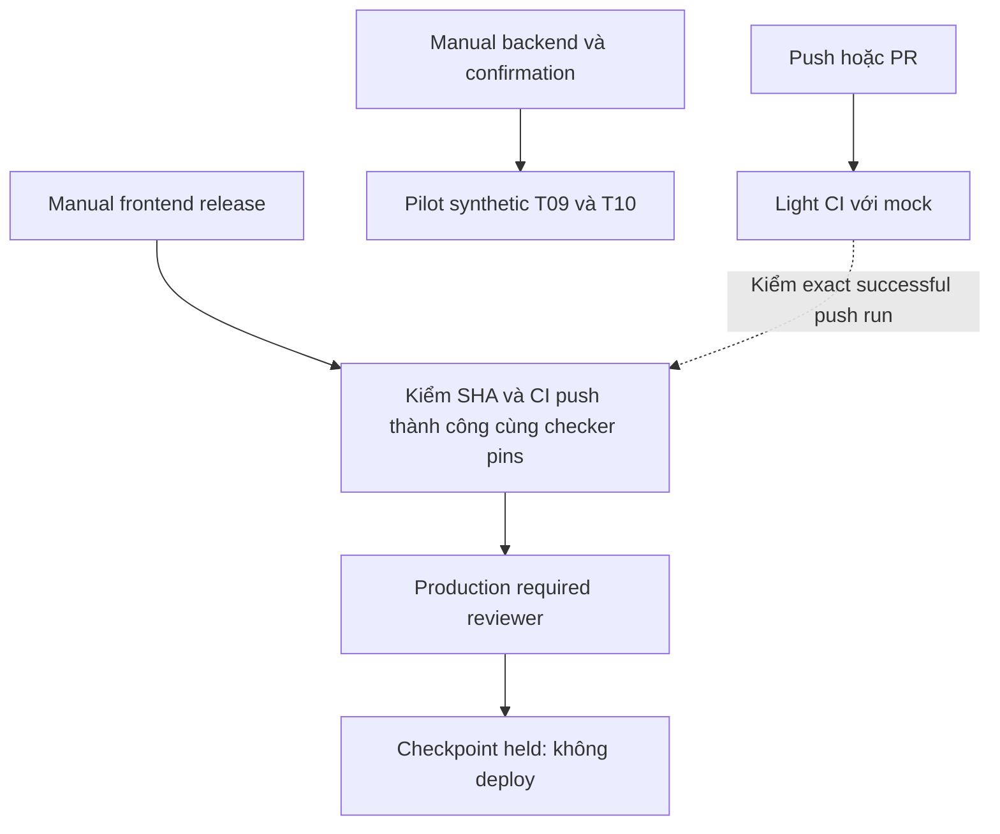

# Setup CI/CD dự án — khởi động 17/10/2026

## Đề bài, quyết định và phạm vi

Owner giao CI nhẹ tự động PR/push, backend thủ công, CD frontend giữ chờ duyệt, chưa phát hành production.

Nhánh triển khai `ci/project-pipeline-20261017` ở `0781f755737747fc8cc810ac5484b12d892013a4`. [CI30](https://github.com/nguyentronglinh045/pos-cafe/actions/runs/39026804330/attempts/1) đã **PASS đủ 11 bước** trên đúng commit: unit1.173, tooling566 + đúng1manualDeferred, Node104, browser preflight1, smoke44PASS+37applicabilityskip/81inventory, UIselftest23, UIaudit48PASS với6finding baseline sẵn có. Source preserved/core restored; peak trong vùng task978.341.888B. Scope light/mock không thay backend acceptance.

[Backend18](https://github.com/nguyentronglinh045/pos-cafe/actions/runs/39027568904/attempts/1) đã chạy thật trên cùng commit và **FAIL**. Bootstrap/Auth/API binding/source preservation đạt. T09 có 1 assertion PASS nhưng suite FAIL/exit1 vì 1 hook error, không có run error; T10 chưa chạy, tổng counts chưa xác định. Chẩn đoán hữu hạn: phase4 `read-fixture`, step13 `cleanup-read`, code17 generic `IMAGE_CLEANUP_STEP_FAILED`, SQLSTATE không xác định; catalog drift mask1, financial drift mask0, các nhóm Storage không có drift trong snapshot. Điều này xác định nhánh lỗi, chưa chứng minh root cause cụ thể bên trong cleanupReadFixture. Cleanup môi trường ngoài đạt, core pattern đã khôi phục.

[CD checkpoint mới](https://github.com/nguyentronglinh045/pos-cafe/actions/runs/39028263852) dùng workflow trên main `f9c566999c4367a5ca54a879fe3b06b5870f26f2`, kiểm exact source `0781f755737747fc8cc810ac5484b12d892013a4` và CI30/attempt1: **preflight PASS, approval WAITING_HUMAN**. Production16685477499 yêu cầu reviewer54500418, chỉ main và admin bypass=false. Tín hiệu `FRONTEND_RELEASE_PREFLIGHT_VALID_PRODUCTION_HELD` đã được đọc trong DOM job117383454382; job approval117383507170 còn waiting. Checkpoint cũ39021837504 đã cancelled vì source lỗi thời. Không approve/deploy; code production=false, chưa có lệnh hoặc token deploy Vercel.

**DEC-CICD-06 — 17/10/2026:** owner trả lời câu 0 của `call_801a8f97fddc4f58a5825cd0bbfe23e5`: “Chốt CI/CD; ghi backend FAIL, sửa fixture ở phiên phân quyền (khuyến nghị)”. Mốc bàn giao này xác nhận CI/CD đã cấu hình và chạy thật; giữ nguyên backend acceptance FAIL, chuyển việc điều tra/sửa cleanup fixture sang phiên phân quyền. Không giảm coverage, đổi baseline/ACL hoặc nhận backend PASS; chưa phát hành production.

Phiên phân quyền tiếp tục từ commit `0781f755737747fc8cc810ac5484b12d892013a4`, run backend18/attempt1 và các ordinals/masks ở trên. Cần xác định lỗi trong cleanupReadFixture, sửa khôi phục catalog đúng baseline và chạy lại toàn bộ T09/T10 trên source mới; không bỏ hook, đổi acceptance hoặc lấy assertion PASS thành suite PASS. Gate production vẫn cần đầy đủ backend và bước bật triển khai được duyệt. TC-IDEM-087 legacy chưa chạy, cần fixture riêng; pilot T09/T10 không phủ case này. Main cũ chưa CI riêng/branch protection, và database/Edge nằm ngoài CD, đúng phạm vi owner đã chọn.

Hồ sơ này được freeze trước công bố. Nhánh đích `docs-ci-cd-20261017` chỉ được tạo sau khi hai reviewer độc lập APPROVE exact manifest và helper công bố; commit message của nhánh ghi manifest cùng hai approvals. Trạng thái công bố cuối được đối chiếu bằng [lịch sử commit của nhánh](https://github.com/nguyentronglinh045/pos-cafe/commits/docs-ci-cd-20261017) và receipt local `artifacts/project-ci-local/docs-published.json`, không tự nhận sự kiện sau freeze trong nội dung snapshot.

[Bằng chứng và hiện trạng chi tiết](../../implementation-log/project-ci-cd-setup-2026-10-17.md).

**DEC-CICD-01 đã chốt ngày 17/10:** owner chọn “CI chạy thật + CD chờ duyệt, chưa phát hành production” qua câu trả lời cho `call_d22d65cbdbd64753902adb36c9c02a71`, câu 0. Mục tiêu là CI thực thi thật và CD có bước owner duyệt; không phát hành production trong đợt setup này. Chưa nâng bất kỳ test local/CI-0 nào thành CI ứng dụng hoặc release PASS.

Giữ quyết định còn hiệu lực: ưu tiên miễn phí, GitHub-hosted standard runner; không tạo lại WSL/Docker Desktop trên máy; một môi trường kiểm thử nặng, task budget 20 GiB và free reserve 30 GiB; không tự giảm acceptance, bỏ tests, đổi ACL/privacy hoặc xóa dữ liệu. CI-1 pilot trước đây chỉ xuất safe log/Job Summary, không raw credential/backup hoặc archive/artifact/cache lớn.

Lịch sử hai câu hỏi trước khi owner trả lời (đã đóng theo DEC-CICD-02/03 bên dưới):

- **Q-CICD-02 — trigger sau pilot:** CI nhẹ tự động PR/push và backend nặng manual (khuyến nghị), tự động cả hai, hoặc tất cả manual. Chặn cấu hình trigger/đăng workflow tương ứng; không chặn khảo sát và worktree local.
- **Q-CICD-03 — phạm vi CD:** frontend Vercel với DB/Edge theo bước riêng (khuyến nghị), hoặc cả Vercel và migrations/Edge Supabase trong pipeline. Dù chọn frontend riêng vẫn cần backend tương thích trước release. Chặn phần triển khai CD phụ thuộc, không chặn inventory CI.

**Quyết định mới 17/10 — DEC-CICD-02/03:** owner trả lời trực tiếp “Chọn CI nhẹ tự chạy theo PR/push, backend nặng chạy thủ công. CD chỉ quản lý frontend Vercel, database/Edge làm riêng. Bạn lên kế hoạch rồi tiếp tục setup nhé, chưa phát hành production.” Q02/Q03 đã đóng; được lập kế hoạch và tiếp tục setup/CI thật trong scope đó. Không mở quyền phát hành production. [Bộ spec và kế hoạch tooling](../../../openspec/changes/setup-project-ci-cd/proposal.md).

## Lịch sử khảo sát ban đầu — trước bootstrap và quyền admin

Chat publication `01a13d35-e425-75d1-9d89-6403a3535e45` đã push atomic hai evidence refs theo lệnh owner và giữ main/docs không đổi, không CI/DB/deploy. Root kiểm `git ls-remote` mới ngày 17/10:

| Ref origin | SHA |
| --- | --- |
| `main` | `5156820f7d6679cd6f8051bdc38419737ffa0c7e` |
| `docs` | `132e9d6cc065459031ee92cfbafcd423b5ac81c5` |
| `evidence/permission-20261016` | `43921c7ebd957bf926bb45411eed849874ade446` |
| `evidence/permission-docs-20261016` | `d62aa4b50a44fbbf69796d37d9f0dda62b3cd805` |

Code triển khai CI dùng **worktree mới `D:/Workspace/pos-cafe-ci`**, nhánh `ci/project-pipeline-20261017`, HEAD `43921c7ebd957bf926bb45411eed849874ade446`, sạch sau tạo. Không sửa nhánh evidence hoặc checkout gốc main có thay đổi chưa commit. Worktree mới có 848 tracked files, 13.342.524 B logical theo Git; dự trù 20–40 MiB, peak 64 MiB trên D cho bước tạo. C/D trước tạo 201.241.448.448 / 102.743.265.280 B; sau tạo 201.240.690.688 / 102.725.906.432 B. Không quy toàn bộ biến động free disk cho task; không áp quota OS.

Repo POS là public, credential CLI hiện có quyền push nhưng không admin; repo CI riêng `nguyentronglinh045/pos-cafe-ci-preflight` hiện chỉ có workflow active `Permission Linux CI-0`. Quyền cấu hình environment protection/required reviewers ở repo tổ chức sẽ cần repo admin; chưa đổi credential hoặc quyền.

## Lịch sử đầu vào và khoảng trống lúc khởi động

- [CI-1 worker local đã review](permission-ci1-worker-local-2026-10-16.md): source/harness/intake/safe reporter, 33 Node tests lịch sử PASS, actual Linux/backend chưa chạy.
- [Pilot tối thiểu D11](permission-linux-ci1-minimal-2026-10-15.md): T09 1 case + T10 3 cases trên backend synthetic đủ service, không thay full PIN19/PERM60/HP1 hoặc gate release.
- `D:/Workspace/pos-cafe-ci/scripts/permission-ci1-worker.mjs:83` hiện ràng buộc repo CI riêng, manual event, Linux GitHub-hosted/root/4 CPU và source/workflow SHA; không bê nguyên worker sang repo/trigger khác rồi gọi là đã phù hợp.
- `D:/Workspace/pos-cafe-ci/scripts/permission-ci1-policy.mjs:4` có budget/limits cần readback thực; cờ trong YAML hoặc receipt không thay enforcement.
- `D:/Workspace/pos-cafe-ci/package.json:6` có build, Vitest, smoke, UI audit và tooling. Cần inventory lệnh/coverage trước khi chốt nhóm CI nhẹ; log public phải giữ ranh giới safe output.
- Vercel main hiện còn auto Production; Preview OFF đã kiểm ở task trước. Thiết kế CD cần đóng đường deploy vượt qua CI/approval trước khi có thể nhận cơ chế duyệt đã được thực thi. Chưa thay Vercel ở task này.

## Kế hoạch triển khai đã chốt phạm vi

1. Q02/Q03 đã chốt; lập spec/testplan/traceability theo chuẩn tooling, dùng lại các requirement còn đúng và phân biệt pilot, CI nhẹ, full backend, release.
2. Triển khai/kiểm local workflow và helpers trên worktree CI; pin source/lock/actions/tools, giới hạn thời gian/concurrency/dung lượng, kiểm public output; hai reviewer kiểm final candidate.
3. Công bố đúng workflow/source đã review và chạy pilot thực tế trên GitHub theo scope được chốt. Mọi tải/cài phải có estimate download/retained/peak trước thực thi; backend recipe hiện **LỚN HƠN 1 GB** nhưng chưa tải/cấp phát ở checkpoint này. Nếu không vừa cap thì dừng, không nới cap hoặc tạo WSL.
4. Thiết lập CI thường xuyên theo Q02; chuẩn bị CD theo Q03, approval thật và source-bound checks. Kiểm cơ chế chặn bằng trường hợp CI fail/chưa approve mà không phát hành production. Không nhận manual trigger đơn lẻ là required approval đã bật.

## Nguồn nền tảng và handoff hiện tại

[GitHub billing](https://docs.github.com/en/billing/concepts/product-billing/github-actions) xác nhận standard hosted compute cho public repo miễn phí; artifact/cache có allowance riêng. [GitHub environments](https://docs.github.com/en/actions/how-tos/deploy/configure-and-manage-deployments/manage-environments) mô tả required reviewers và quyền admin. [Vercel Git configuration](https://vercel.com/docs/project-configuration/git-configuration) mô tả điều khiển auto-deployment; đây là tài liệu thiết kế, chưa là cấu hình đã áp dụng.

Checkpoint lịch sử trước quyết định/implementation: mới tạo worktree và hồ sơ, chưa cài hoặc thực thi CI/online. Hiện Q02/Q03 đã đóng theo owner; source workflows/controller/reporters đang triển khai trên worktree CI. Tests local đầu45PASS, chưa actual CI/backend/CD protected. Review sớm trả CHANGES_REQUESTED cho binding/matrix/allowlist/CD protection; đang sửa theo code/design, sẽ review final candidate. Không tuyên bố setup hoàn tất.

Checkpoint implementation tiếp theo: candidate01 bị cả hai reviewer CHANGES_REQUESTED. Đã sửa root Git ownership bằng exact safe.directory ở light/backend; tách hai empty npm configs; tạo release pins từ canonical Git blobs và bổ sung detector/fixture/smoke helper. Local suite mới49/49PASS,0skip. actionlint1.7.12 tải chính thức2.479.065B, SHA2566e7241b51e6817ea6a047693d8e6fed13b31819c9a0dd6c5a726e1592d22f6e9; kiểm ba workflow, không cài hệ thống. Temp tool/archive giữ tại D:/Workspace/pos-cafe-ci/artifacts/project-ci-local/actionlint, chưa xóa.

vercel.json candidate đặt git.deploymentEnabled=false để chặn Git auto deploy khi config được công bố; chưa áp lên main/provider. Browser read-only GitHub /settings/environments trả404 với tài khoản nguyentronglinh045, nhất quán API push=true/admin=false. Preview Branch Tracking Vercel đã đọc lại OFF; không coi đó là đã chặn main. Chưa cấp quyền admin/workflow OAuth, chưa production, chưa CI/backend thực.

Checkpoint online: candidate02 SHA256d573f0c286416e2258477a829e9022e16a91521076ff6088e1f5a6c36bfdcefa được cả hai reviewer APPROVE cho local/feature publication. Đã push helpers14f8507 rồi công bố ba workflow bằng GitHub web dưới cùng tài khoản nguyentronglinh045 (CLI OAuth thiếu workflow scope, không mở rộng credential). Đối chiếu18Gitblobs khớp candidate; final feature SHAed3272cc7500d011d6dd027f169e49cca948d24c tree78ead9fc5bff7e92f13bae5afb265bb2bdc95cdf, worktree sạch sau align. Main/docs/evidence refs chưa sửa.

[Actual light CI run39000070099 attempt1](https://github.com/24tx810010-hcmute/pos-cafe/actions/runs/39000070099/attempts/1) trên exact source/workflow ed3272c: installPASS9.008s, buildPASS12.866s, unitFAIL94.595s/exit1; phases sau NOT_RUN. SourcePreserved=true, lockSHA85969c1c161f74e9f68563182d99d1b0ac6fb5f17f5074444f329675ffd34e18; peakOwned414.396.416B (~395MiB), operatingcap5GiB/reserve30GiB. Raw output giữ private runner và không export; bản đầu chưa có diagnostic đủ để phân biệt unit/assertion/coverage/runtime nên chưa kết luận nguyên nhân. Đang bổ sung finite safe diagnostics và chạy lại exact candidate mới, không đổi acceptance/baseline.

Owner trả lời câu hỏi quyền: “Tôi sẽ đăng nhập tài khoản chủ repo”. Đã mở GitHub account switcher đến màn hình đăng nhập24tx810010-hcmute cho owner tự nhập password/2FA; chưa xác nhận đăng nhập hoặc cấp admin thành công. Scope chỉ cấu hình duyệt, không production.

Candidate04 SHA2561cf3c76830a1d6ca7edc168360aed2d950945f987b34cedb2aea4eb2c4949466 được cả hai reviewer APPROVE sau khi CICD-03/testplan đồng bộ diagnostic allowlist; publish diagnostic source9e788022dccbf7d98f7296f582115c02ed09894f. [Run39000470658/attempt1](https://github.com/24tx810010-hcmute/pos-cafe/actions/runs/39000470658/attempts/1): install/buildPASS, unitFAIL94.507s/exit1,1173total/1172pass/1fail/0pending, failed file src/architectureBoundaries.test.ts. SourcePreservedtrue/peak414.404.608B. Không đổi unit test để xanh. Static AST đọc-only trên Windows dùng TypeScript5.9.3 sẵn có chưa tìm violation, nên chưa kết luận import/rule cụ thể; không nhận phép static này là Vitest/LinusPASS. Bổ sung ordinal assertion dạng số để chẩn đoán tiếp.

API mới xác nhận environment có sẵn Production(id16685477499) và Preview(id16790483292), đều0protection_rules/can_admins_bypass=true/branch_policy=null; GET tên production trả đúng Production. Sửa guard so tên không phân biệt hoa-thường theo GitHub semantics, tái dùng environment/history hiện có; không xóa hoặc tạo duplicate. Chưa thay cấu hình bảo vệ khi chưa login admin.

**DEC-CICD-04:** trong lúc setup, repo được owner chuyển cùngID1263057386 sangnguyentronglinh045/pos-cafe. Owner xác nhận “Dùng nguyentronglinh045/pos-cafe mới”. CLI/browser tài khoảnnguyentronglinh045 đãadmin; origin đổi sanghttps://github.com/nguyentronglinh045/pos-cafe.git (sharedremote trong cácworktrees cùngrepo), không đổirefs. Candidate05 đã haiAPPROVE và publishe395b4cd3d26b3b9981d6ff3aae794137a82e195; [run39000839620](https://github.com/nguyentronglinh045/pos-cafe/actions/runs/39000839620) SKIPPED/0steps do exactoldslugguard, không nhận làPASS. Đang cập nhật canonicalslug +stableID và review targetproduction protection; chưaapplyadmin/provider/main/deploy.

Candidate06SHA2566af508bac113d129094c4ccc2fc454df1c1f344379a8344d0e4368c55ba311af được cảhaiAPPROVE cho featurepublication+environmenttightening. Đã dùng SSH key đã có (authnguyen, không mở rộngOAuth) push11paths canonical/ID lên116bbb6331fdf6d5ecff796d5605f6f8ffeef74f; [run39001225009](https://github.com/nguyentronglinh045/pos-cafe/actions/runs/39001225009) đang chạy. ProtectionexistingProduction16685477499 đãáp bằngbrowser+branchAPI; readback04:05:44UTC reviewer54500418/preventSelfReviewfalse/adminBypassfalse/custommainbranch duy nhất đạt pureverifyReleaseEnvironment. Không secrets/token/deploy được thêm. Đây là cấu hình bảo vệ thực, chưa runtime approval gate test/defaultbranchbootstrap.

Vercel đọc mới xác nhận bindingnguyentronglinh045/pos-cafe tự cập nhật, noDeployHooks. Đồng thời thấy thay đổi ngoài phiên: main nay4a89cc390894f5f35b61990e4f950a5eb6e481b9; ProductionReadyGf8TritxT3TLC6gSQCp97JWyfjgP từ mainSHAđó, creator24tx610002-VoVanNgoc, created03:59:30UTC. Agent không pushmain/deploy/promote/alias hoặc phục hồi/xóa deployment này. Không còn nhận Production/main toàn cục giữ5156820. Evidencebranches/docsref vẫn nguyên. IgnoredBuildStep vẫnAutomatic; chuẩn bịreview holdDon’tbuildanything/exit0 để chặn futureGitbuild trước bootstrap. Không coi hold đó là chặn mọi manual/API deployment.

Candidate07SHA256fd4ef5f95ed4e1b2b7426b09b765d9afa8e017ed1fcb263c5f2f99e8042bb23d được cảhaiAPPROVE cho providerhold. Đã save Don’tbuildanything/exit0, reloadVercelsettings rồi mởIgnoredBuildStepProjectSettings: preset/command còn đúng và Save disabled. GiữReadyGf8 deployment, khôngdeploy/promote/alias/delete/reconnect/grant. HoldfutureGitbuild có thể tạoCANCELEDrecord, không0deploymentAPIclaim.

Actualrun39001225009/attempt1 trên116bbb6 đãFAIL: install/buildPASS, unit1173/1173PASS/0skip trong72.627s, tooling566/567PASS/1FAIL/0pending tại tests/contracts/gates.tool.test.ts, cácphase sauNOT_RUN; sourcepreservedtrue/peak417.734.656B. Hai rununitfailure đầu giữ nguyên lịch sử, chưa tuyên bố tìm/đã sửa nguyên nhân architecture vì runmới khôngsửaapp và đãPASS.

Đọc testgates tìm thấyTC-IDEM-087/tool cópositiveDBwrite/Auth/REST/migrationchecksums, không phải toolingthuần. TheoDEC-CICD-02, phân tuyến exact1case sangmanualbackendcommandnpmrun test:idempotency:tools trên dedicatedlegacyfixture; sourceassertions không đổi và pilotT09/T10 khôngcovercase này. Light giữ567discovery/566required/exact1manualpending, reportskip/manualDeferred riêng; mọi skip/fail/thiếu khác vẫnreject. Manifest/file/config được canonicalpin; manuallegacycaseNOT_RUN vàfullbackend/releaseacceptance giữ nguyên.

Candidate08 bị reviewerCD CHANGES_REQUESTED cho aggregatepending0/todo1 mâu thuẫn. Sửa pendingriêng/todo0+regression; candidate09SHA256893223317f4000f8539838c7e108365e18da624802796bf1c2db607964de37f4 cảhaiAPPROVE/51localPASS vàpublishc84d0af43ed4683fa8e4f294c2b966bb96d1ece4. [Run39001969113/attempt1](https://github.com/nguyentronglinh045/pos-cafe/actions/runs/39001969113/attempts/1) install/buildPASS, unit1172/1173/1FAIL ordinal1 architecturefoundations, sauNOT_RUN; sourcepreservedtrue/peak414.433.280B. Chưaactualkiểmtoolpartition vìfailunittrước. Chuyểnschedulingunitserial(maxWorkers1/nofileparallelism), khôngtăngtimeout/retry/đổiassertion; diagnosticstripANSI vàchỉfailedmessages đểtìmcausechínhxác. Chưađoánviolationimport hoặc gọiflakefixed.

Trong lúc fetchbootstrap, remote main lên9ce20b4d0840dff24cdab63fbaa821fc1db91f2f (thêm20PNGcủaTrầnThịLâm), vercel.json vẫnkhôngignoreCommand. Đãchuẩnbịtree6file thủcông/held riêng, khôngstage/indexcheckoutgốc. Đang hỏiowner chọnmilestone: nhánhmới+6filemanualbootstrap trước, haythêmprofileCIcho maincũngay. Chưaupdate main vàkhôngsuydiễn quyềnmergeapplication.

**DEC-CICD-05 (đã chốt, 17/10):** owner trả lời “CI cho nhánh mới + bootstrap manual/CD trên main trước (khuyến nghị)”. Hoãn profile CI cho ứng dụng main cũ; không merge ứng dụng phân quyền. Câu hỏi milestone phía trên đã đóng theo trả lời này.

Candidate10 `bb4df46baadb408a5681a022f29dcdf4c61c3af6075ae278cb949be482eaa503` được cả hai reviewer APPROVE cho feature publication; 51/51 local PASS, ba workflow actionlint PASS. Đã publish bốn file scheduler/diagnostic/test/policy lên `5e86599fc442165bffe162b6372e6666164242ff`; actual light [run39002558426](https://github.com/nguyentronglinh045/pos-cafe/actions/runs/39002558426) đang chạy, chưa có kết luận.

Bootstrap manifest `f954c9c6271bde1831cca65a1107cc0e23c4b9beb388b0ea7671493df757168c`, tree `9cbb9c4728e202d0c6649828a7fdf500bfdd7baa` trên parent `9ce20b4d0840dff24cdab63fbaa821fc1db91f2f` được cả hai reviewer APPROVE riêng. Kiểm độc lập đúng 6 changed paths, 23.224 B/407 dòng thêm, 504 paths khác giữ nguyên; actionlint hai workflow/node syntax/diff-check PASS. Đã reload/readback Vercel Don’t build anything/exit0 ngay trước push, đối chiếu remote parent rồi push fast-forward **`f3cea61aa62fe8994b1fc325de3da7b3e420c159`** lên nhánh `ci/manual-bootstrap-20261017` và `main` lúc04:28:46UTC, không force. Không chạm checkout/index main gốc. GitHub đã đăng ký hai manual workflows active. Backend trên main dừng fixed message trước setup-node vì main chưa có worker; chọn nhánh CI đã review để chạy pilot. Đang actual negative CD [run39002739692](https://github.com/nguyentronglinh045/pos-cafe/actions/runs/39002739692) với CI run5 FAIL; chưa nhận runtime approval gate PASS hoặc phát hành production.

Kết quả actual CI6 `39002558426/attempt1`, source5e86599: install/build PASS, unit1173/1173/0skip PASS (162,944s), tooling567discovered/566run/566pass/1manualDeferred PASS (34,673s), Node51/51PASS, browser/discovery PASS. Smoke FAIL sau215,379s với exitCode null, counts/report thiếu; UI selftest/audit NOT_RUN. SourcePreserved=true, peakOwned716.304.384B. Chưa đủ nguyên nhân để nhận guard hay application defect; thêm finite guard/signal/resource diagnostics, không đổi assertions/caps hoặc nhận full CI PASS.

CD negative run39002739692 trên mainf3cea61 đã completed/failure: fixed FRONTEND_RELEASE_BLOCKED, preflight FAIL, approval SKIPPED. Đây là negative-control PASS cho việc từ chối CI FAIL, không là approval/deploy PASS.

Backend manual [run39003128340/attempt1](https://github.com/nguyentronglinh045/pos-cafe/actions/runs/39003128340), exact5e86599: workflow dispatch thật, FAIL; completed chỉloop, bước source-tools chưa hoàn tất, T09/T10 NOT_RUN. Trước chạy đã báo LỚN HƠN1GB, download dự kiến2,5–3,5GB, filesystem18GiB/task20GiB remote; không cài Windows, không chạy CI light đồng thời. Worker cũ chưa xuất loại lỗi/cleanup riêng nên không nhận teardown proof PASS. Đang bổ sung allowlisted stage/operation/command/code và bool cleanup, chưa đổi limits/acceptance. Giữ lịch sử FAIL, chưa rerun cùng source.

Candidate11 hai APPROVE/53localPASS được publish9e734dce75001f241fff6820b75e0fd96b1e17d5. [CI7/39003548092](https://github.com/nguyentronglinh045/pos-cafe/actions/runs/39003548092) FAIL: unit1173/tooling566+1manualDeferred/Node53 PASS; smoke dừng290,388s, RESOURCE_FREE_SPACE/PROCESS_SIGTERM, minfree32.044.953.600B dưới30GiB; peakRAM2.562.969.600B/PIDs194, OOM/PIDs events0; sourcepreservedtrue/ownedcheckpoint712.183.808B. UI NOT_RUN. Không nới reserve để xanh; thêm LimitCORE=0/readback và current-owned/core/initial-free facts, chưa kết luận coredump là nguồn tăng đĩa.

[Backend2/39004143668](https://github.com/nguyentronglinh045/pos-cafe/actions/runs/39004143668), source9e734dc: FAIL, completedloop, EXTRACT_NODE/GUARD_REFUSED/commandnull, cleanuptrue; T09/T10 NOT_RUN. Thêm safe numeric supervisor/loop facts, không đổi assertions. Probe local synthetic Git không tái hiện lỗi ownership nên không sửa theo giả thuyết. Official Node57.023.429B/checksum2faf6a... archive metadata hợp lệ; Supabase55.598.482B/checksum69c05f... có supabase+supabase-go, intake cũ từ chối companion. Đây là lỗi prep độc lập đã tái hiện; sửa exact two-binary intake và đặt cả hai cùngruntime/bin theo vendor docs. Probes chỉ stream metadata, không lưu archive/giải nén/cài Linux runtime trên Windows; failed helper invocations không được nhận evidence hợp lệ.

Candidate12b được CI reviewer APPROVE nhưng CD reviewer CHANGES_REQUESTED do bảng current staleCI7; sửa docs-only thành12c SHA256f9ca67e8929548aee61455da2db9a34805d5939cde5239322a1eaae0f67e9f2d, cảhaiAPPROVE/55localPASS/lint3 và publish9261aa1227c71db8afd9803a2b3ffd0bc40fce6d. Xác minh exactsource/event/path rồi cancelCI8run39004677845/attempt1, đợi completed/cancelled mới dispatchbackend3run39004739464. Không nhận canceled làPASS hoặc đổi assertion retries.

Backend3 trên9261aa1 FAIL source-tools/EXTRACT_NODE/LOOP_REFUSED, cleanuptrue. Facts: image logical19.327.352.832B (18GiB), allocated19.140.730.880B, fs18.843.648.000B/free17.778.561.024B, offset0/limit18GiB/mount/owner đúng. Guard từ chối vì thiếu186.621.952B physicalreservation; không phải lỗi Gitclone hay archiveNode. Đang sửa mkfs đồng bộ inode/journal và reserve lại trước mount, vẫn kiểm đủ18GiB suốt run; chưa chứng minh LinuxPASS. Mainpolicy chưa refresh vì chưafullCI, production vẫn held.

Checkpoint candidate14: candidate13 đã haiAPPROVE/publish1015790. CI9run39005172048 cố ýCANCELED/terminal trước backend4run39005271535; backend4 vượtloop+source-tools, FAILnpm-images/INTAKE_REFUSED/cleanuptrue, chưa T09/T10. Probe378archives/SRIverified/195.942.868B chỉmetadata cho thấy20 @types named roots bị parser package-only từ chối. Parser mới bind @types tên/version từ exactregistryURL, chỉ mộtroot, vẫn reject traversal/device/hardlink/symlink/expandedoverflow. Probe20affectedarchives633.584B trênparsermới20accepted,0tar/SRIerror, khôngarchive/extraction/install. FiniteNPM_DOWNLOAD/INSPECT/CACHE; không thay business/resource/coverage acceptance. Full CI/mainpolicyrefresh/positiveapproval vẫn chờ actualsuccess.

Candidate14 SHA256d04c113437df5ab98fcb7c1a0269115ba3476af60e9982fb3fbe9f7c8159cc11 haiAPPROVE/fresh56PASS/lint3, publish8e28b01. CI10cancelterminal rồi backend5run39005522371. Backend5 vượt npm intake/cache nhưng FAILdocker exit1, operationnull, cleanuptrue; chưa suy nguyên nhân registry/daemon/disk. Probe riêng12 pinned publicECR manifest bằng HTTP từWindows:12HTTP200/exactmanifestSHA/configSHA, khôngpull/downloadlayers/càiimage; không chứng minh runnerGitHub network/dockerPASS. Candidate15 chỉ thêm finite image operations/ordinal và phân loại Dockerstderr trongRAM thành enum, không xuất rawmessage/URL/args/secret.

Lịch chẩn đoán tiếp theo: lần publish15 để auto lightCI chạy đầy đủ trước, chờterminal rồi mới backendmanual cùngsource. Không chạy hai runtime đồng thời, không đổi retries/coverage/matrix/acceptance. Nếu source còn đổi thì fullCI cuối vẫn phải chạy lại sourcecuối; các FAIL/CANCELED giữ lịch sử.

Checkpoint15 đã publish893538e sau hai APPROVE; CI11run39006023943 đang chạy đầy đủ. Backend dừng chờ CI terminal, chưa fullCI/backendPASS. Bảng hiện trạng và metadata review mới nhất ở implementation log.

## Chẩn đoán CI11 và backend6

CI11 source893538e có đầy đủ unit1173/tooling566+1deferred/Node57 PASS, smoke dừng210.859ms vì free space dưới30GiB; không nhận UI hoặc smoke PASS. Ổ host giảm khoảng59,6GB trong khi owned chỉ712MB; đây là tăng ngoài vùng task đã đo, không được nhận operating cap5GiB đã bao trùm mọi ghi của kernel. Core pattern là pipe dù hard/softLimitCORE0. [Linux core(5)](https://man7.org/linux/man-pages/man5/core.5.html) xác nhận piped handlers không chịu RLIMIT_CORE; chưa trace để chứng minh toàn bộ59,6GB là core dumps.

Candidate16 tạm đổi kernel core_pattern sang core trên duy nhất VM GitHub-hosted tạm của job, vẫn LimitCORE0; controller đọc lại mỗi checkpoint và từ chối drift. Launcher dừng exact owned unit và xác minh inactive/collected cộng recursively empty/ENOENT cgroup trước khi khôi phục đúng bytes pattern cũ; lỗi đọc/stop hoặc còn descendants thì fail closed, không khôi phục pipe đang có browser sống. Job bị kill/cancel có thể không chạy finally, VM sẽ được GitHub hủy; không nhận đó là proof restoration PASS. Không sửa kernel/WSL/Docker trên Windows.

Thêm guard bảo thủ host free decrease5GiB, ngoài owned5GiB/reserve30GiB, không nhận polling guard là quota OS. Smoke dùng line+JSON private để lấy lỗi launch trước khi reporter JSON hoàn tất; public chỉ finite browser codes, không raw stderr/titles/stack. Giữ tests/coverage/matrix/timeouts/retry0/UI baseline. Canonical19pins được cập nhật; main vẫn pin checker5e cũ và chưa publish refresh.

Sau CI11terminal mới dispatch backend6. Backend6 vượt npm-images và12imagechecks, FAILedge-network-warm/GUARD_REFUSED/commandnull/ordinal12, cleanupfalse. Chưa đủ dữ liệu phân biệt cache guard và teardown step; không đoán sửa cache closure hoặc giảm acceptance. Đây là blocker backend tiếp theo, chưaT09/T10.

Checkpoint16: sourceb10933b published đúng5file sau haiAPPROVE/60localPASS/lint3;CI12run39007166096 đang smoke sau bảyphasePASS. Backend6stillFAIL/cleanupfalse; backend17diagnosticlocal chưapublish. Xem bảng hiện trạng implementationlog trước mọi kết luận.

## CI12 và candidate17

CI12 trênb10933b xác nhận guard core mới chạy thật: kernelCorePipe0, host decrease698.421.248B/peakowned712.290.304B, khôngOOM/PIDevent, còn90.902.732.800B và sourcepreservedtrue. Launcher đã xuất fixed restoration signal sau unit/cgroup check và readback. Không nhận toàn bộ tăng59,6GB của CI11 đã có syscall proof root cause; chỉ ghi cơ chế bypass đã chặn và lượt mới không tái diễn growth đó. Smoke vẫn FAIL sau480.350ms vì test/command timeout; report chưa hoàn tất, chưa biết case/helper cụ thể. UI NOT_RUN.

Candidate17 thêm smoke-preflight: chạy lại đúng case có sẵn desktop/pos-cafe.spec.ts:119 với timeout/assertions/retry0 gốc. Preflight1case là diagnostic bổ sung, không thay matrix81/6projects/37applicabilityskips hoặc UIselftest23/audit48. PASS tổng đòi đủ11phases; subset không thể thành fullsmokePASS. Preflight FAIL dừng phần phụ thuộc và có report riêng để định vị nhanh. Public diagnostics chỉ thêm counts nguồn report, projectordinal1..6, source line/helper line nguyên dương<=1.000.000 và progress index/total<=10.000; progress chỉ observed diagnostic, không dùng để xác nhận pass/count acceptance. File path vẫn phải thuộc Git inventory/failed report, max32. Raw title/message/stack/private paths không export.

Candidate17 — backend diagnostics tại mốc backend6 FAIL — chỉ thêm finite EDGE_VOLUME/BUNDLE/CACHE_PROOF operations, cache failure enum, knownpackage ordinal và numericversion/copy; mọi root/type/version/pin/SRI/tarball/dependency/expanded-bound checks giữ nguyên. Cleanup failure được báo riêng để không che lỗi chính; unmount thất bại thì không detach loop còn mounted. Wrapper success độc lập đòi outercleanuptrue/cleanupFailurenull cùng COMPLETE và D12PASS. Fixture test chứng minh D12PASS giả không vượt qua teardownfalse; không là actualpilot evidence. Backend6 vẫnFAIL/cleanupfalse, T09/T10NOT_RUN. Main policy/CDpositive vẫn chờ actualfullCIgreen, productionheld.

## CI13 và chẩn đoán candidate18

CI13 exactb29a605 chạy preflight đúng1case: FAIL67.329ms vì TEST_TIMEOUT, có JSON report1unexpected, không raw message/stack export. Không có helperline/browserfailure category nên chưa xác định browser fixture, navigation hay application assertion. Full smoke/UI vẫn NOT_RUN. Tổng light vẫn FAIL, không hạ timeout/assertions/matrix để xanh. Host decrease696.561.664B, noOOM/PIDlimit, sourcepreserved/restorationtrue; không tái diễn tăng59GB ở lượt này.

Candidate18 chỉ bổ sung finite API categories BROWSER_CONTEXT/BROWSER_PAGE/PAGE_NAVIGATION/LOCATOR_ACTION/ASSERTION_VISIBLE/FIXTURE_SETUP/FIXTURE_TEARDOWN và số dòng/cột nguyên dương<=1.000.000 trong known failed source file. Chúng là observed diagnostics, không dùng thay acceptance counts, không xuất API args, title, message, stack, URL hoặc private path. Regression đi qua nested Playwright report và publicSummary, loại fake secrets/private paths và unknown source. Chưa sửa application hoặc test assertion. Backend7 đang chạy trênb29a605; chưa nhận actualpilotPASS.

## Backend7: kết quả thực và candidate18

Backend7 exactb29a605 completed loop/source-tools/npm-images, đủ12images. Primary failure EDGE_CACHE_PROOF/EDGE_CACHE_PIN tại packageordinal8 (@types/node), version22.5.4/copy0. Teardown riêng CLEANUP_UNMOUNT/umount exit32, cleanupfalse; không nhận D12/T09/T10 PASS hoặc teardown đã sạch.

Candidate18 giữ18pins cũ và thêm đúng @types/node22.5.4 đã thấy trên runner cùng undici-types6.19.8 thỏa dependency~6.19.2. Metadata chính thức4.835/1.731B, archive404.125/21.139B được stream/SHA512 SRI verified, không lưu archive/giải nén/cài trên Windows. Receipt2f0c842a4641461fb3c38d21e035157b324400b8c30b0b2e87aad062b0f97e9b. Đây là pin version cụ thể đã kiểm, không cho qua unknown version/peer copy/entry; metadata/SRI/tar/dependency/file/bound checks giữ nguyên. Cần actual Edge proof để biết toàn bộ closure đã khớp.

Bundle containers đổi sang Docker --rm để tự xóa container khi lệnh kết thúc, giữ named Deno volume cho offline proof; không prune/reset hoặc lazy/force unmount. Điều này xử lý một nguồn mount lifecycle còn giữ; chưa chứng minh root cause toàn bộ umount32 hoặc cleanup đã PASS. [Docker run](https://docs.docker.com/reference/cli/docker/container/run/#clean-up---rm) mô tả --rm; named volumes được giữ.

Resource gap được đóng trong source: backend dùng chung adapter core_pattern core/verifiedrestore với light trên duy nhất VM GitHub tạm, backend unit LimitCORE0, Docker default-ulimit core=0:0 và bundle explicit ulimit0. Worker supervisor/harness đọc lại hard+soft0 và regular core pattern. Adapter chỉ nhận exact owned light/ci1 unit; trước restore phải stop/inactive hoặc collected và recursively empty cgroup, giữ failclosed nếu không xác minh được. Không đổi WSL/kernel trên Windows; chưa nhận enforcement backend thật trước lượt mới. Regression từ chối arbitrary unit, piped pattern/nonzero limit, missing/duplicate daemon default ulimit. Các CPU/RAM/PID/fs/time/coverage/acceptance giữ nguyên.

Candidate18 bị hai reviewer CHANGES_REQUESTED trước publication vì Docker default-ulimit có thể bị từng container override. Candidate18a thêm actual /proc/<State.Pid>/limits cho đủ12runningservices với12PID riêng: hard/soft đều0, patternregular; missing/readerror/EACCES/nonzero/stopped/invalidPID/duplicatePID/incompleteinventory đều refuse. Envelope bắt buộc containersCoreDisabled=true, thiếu field cũng reject. Short-lived bundle chỉ claim explicitulimit configuration+regularkernelpattern, không giả vờ có running-process snapshot sau khi nó đã kết thúc. Chưa Linuxbackend readbackPASS trước lượt18a mới.

## Candidate19: smoke step reporter, optional metadata và teardown

CI14 actual543a3fe: unit1173/tooling566+1deferred/Node67 PASS; preflight FAIL67.741ms, ASSERTION_VISIBLE/TEST_TIMEOUT. Dòng119:1 từ reporter header là test declaration, chưa là vị trí assertion hoặc root cause UI. Candidate19 dùng custom observer reporter ngay trong project-ci-results.mjs đã có trong19trustedpins, giữline+JSONreporters. onStepEnd/onTestEnd chỉ xuất tối đa32records với fixed schema/ordinals/knownfile positive linecolumn<=1.000.000 và duration<=480.000ms; không onEnd/status override/test mutation. Marker private chỉ cung cấp observed diagnostics, không acceptance counts. Ưu tiên actual step location qua header. Rawtitle/message/stack/URL/args không export; chỉ finite code/ordinals. Regression kiểm loại secret/unknownpath/hostileordinal, cap32, observedfailure vẫnFAIL.

Ordinal maps: locators1landing-screen/2store-pairing-screen/3passcode-screen/4floor-page/5order-drawer/6submit-order-button; category1pw:api/2expect/3fixture/4hook/5test.step/6test.error; source1pos-cafe.spec.ts/2helpers.ts/3permission-ui-closeout.spec.ts/4demo-runbook.spec.ts. API1browserType.launch/2browser.newContext/3browserContext.newPage/4page.goto/5locator.click/6locator.fill/7toBeVisible/8toBeHidden/9browserContext.close/10browser.close/11page.waitForLoadState/12page.waitForURL. Ordinals chỉ là quan sát, không chứng minh test PASS.

Backend8 actual543a3fe đã vượt lỗi pin22.5.4 trước, rồi EDGE_CACHE_METADATA tại packageordinal11/bufferutil, chưa có facts chứng minh entries cụ thể. Optional-metadata-only là giả thuyết format cần kiểm ở lượt mới. Metadata official ws8.22.0 xác nhận bufferutil/utf-8-validate optional peers; node-gyp-build là dependency trong hai pin peer đã kê. Receipt2.473B/SHA19e46c25aee0f363b5ee023af66ac3800482c18741cc95f236ba1fe15f1db039.

Candidate19 khai báo metadataOnlyAllowed chỉ bufferutil4.1.0/utf-8-validate6.0.6/node-gyp-build4.8.4, pins đã có giữ nguyên. Chỉ đúng một registry.json regular/nonsymlink/bounded, exactname/version/SRI/tarball/dependencies mới được nhận; bytes được tính cap512MiB và contenthashed vào private cacheproof. Không tính metadataOnly vào observed installed packages; root thật vẫn phải installed, offline bundle/stack/T09/T10 vẫn bắt buộc. Requiredpackage thiếufiles, unknownentry/version, badmetadata/SRI/symlink vẫn reject. Parser không bỏ qua dữ liệu để tiết kiệm dung lượng.

Backend8 cleanup vẫnfalse/umount32, --rm chưa đủ để nhận teardownPASS; source không kết luận process giữ mount hoặc nestedmount là root cause. Candidate19 kiểm findmnt submounttree: top phải exactownedroot/loop, mọi target canonical trongroot, max4096; kiểmbackingfileexactlayout.image trước khi normal recursive unmount. Không kill hostPIDs hoặc force/lazy unmount/prune. Nếu mountbusy thì vẫnFAIL và khôngdetachmountedloop. Chỉ thêm finite UNMOUNT_BUSY/PERMISSION/NOT_MOUNTED, numeric nestedmountcount/entrycount/registrypresent để phân biệt lần sau. [umount manual](https://man7.org/linux/man-pages/man8/umount.8.html) xác nhận normal --recursive dừng khi chain thất bại. Actual backend pattern restore signal=true, nhưng chưa tới12service readback/T09/T10; không nhận core-container/Pilot PASS.

Candidate19 bị package reviewer CHANGES_REQUESTED trước publish: metadata-only files có thể làm totalfiles>0 dù root versiondir trống. Candidate19a thêm counter riêng chỉ tăng khi đọc installedfile của expectedroot, bắt buộc rootFiles>0; metadata không tăng counter. Regression rootdir trống+optionalregistry cóbytes phải reject. Không dùng optionalmetadata làm evidence root package đã installed.

## Điểm đọc code cho owner — source71a9ebe

1. [Trigger CI](https://github.com/nguyentronglinh045/pos-cafe/blob/71a9ebe7fcd349370dd8048adfd36e71b6c88476/.github/workflows/ci.yml#L3): push/PR tự chạy trên nhánh CI; main cũ chỉ có bootstrap manual/CD. Đây là DEC-CICD-05, không có merge ứng dụng.
2. [Giới hạn light](https://github.com/nguyentronglinh045/pos-cafe/blob/71a9ebe7fcd349370dd8048adfd36e71b6c88476/scripts/project-ci-launch.mjs#L70) → [11 phase và source guard](https://github.com/nguyentronglinh045/pos-cafe/blob/71a9ebe7fcd349370dd8048adfd36e71b6c88476/scripts/project-ci.mjs#L98) → [public summary](https://github.com/nguyentronglinh045/pos-cafe/blob/71a9ebe7fcd349370dd8048adfd36e71b6c88476/scripts/project-ci-results.mjs#L376): vì sao thiếu smoke/UI không được PASS, raw log/trace không ra public, operating disk guard khác quota OS.
3. [Backend invocation/result gate](https://github.com/nguyentronglinh045/pos-cafe/blob/71a9ebe7fcd349370dd8048adfd36e71b6c88476/scripts/project-backend.mjs#L9): manual confirmation, namespace synthetic, exactsource và cleanup; đọc D12PASS phải kèm COMPLETE/cleanuptrue, không thay full PIN19/PERM60/HP1.
4. [CD guard và khóa production](https://github.com/nguyentronglinh045/pos-cafe/blob/71a9ebe7fcd349370dd8048adfd36e71b6c88476/scripts/project-release.mjs#L7): exact successful CI push/source/attempt +19pins +owner/environment/main; PRODUCTION_ENABLED=false. Positive approval chưa được kiểm khi fullCI chưa xanh; kể cả approval thì workflow này vẫn không deploy.

Đã cung cấp hướng dẫn đọc; **chờ owner đọc/trao đổi**, chưa có phản hồi chứng minh owner đã đọc hoặc hiểu. Các link trên gắn immutable source; kết quả runtime mới nhất đọc ở bảng đầu implementation log. Đây không phải nghiệm thu toàn task hoặc quyền phát hành.

## Checkpoint mới — candidate27a

Candidate27 ban đầu bị cả hai reviewer CHANGES_REQUESTED vì có thể nhận nhầm nested CDP response thành renderer crash; chưa publish. Candidate27a SHA256 `3006d97ce2b6bc124f3c989612130f2821827a74e83ad43fc4ef09e0b1f7f60a` đã được cả hai reviewer APPROVE, 85/85 local tests và ba workflow lint PASS. Regex giới hạn namespace trước JSON và top-level RECV event; regression chặn nested response, SEND và nội dung giả logger. Đã publish đúng bốn file tại `07c73847f836400a73ad800e744f2f19576cb735`; [CI23 attempt1](https://github.com/nguyentronglinh045/pos-cafe/actions/runs/39017387994/attempts/1) tự chạy từ push, hiện đang chạy. Protocol debug chỉ trong preflight, raw output private/bounded; chưa chứng minh crash thật.

[Backend14](https://github.com/nguyentronglinh045/pos-cafe/actions/runs/39016844933) trên source470ea50 đã terminal FAIL: IMAGE_PULL/imageOrdinal1/DOCKER_REGISTRY_RATE_LIMIT/imagePullAttempt3; cả ba lần có chờ vẫn bị giới hạn. Chỉ hoàn tất loop/source-tools; pilot chưa chạy. Cleanup=true, cleanupFailure=null, core-pattern restored được quan sát. Không nhận backoff là đã khắc phục quota hoặc D12 projection đã chạy thật.

## Chẩn đoán hiện tại và phép thử tiếp theo

CI23 source07c7384 / run39017387994 attempt1 đã terminal FAIL. Build, unit1173/1173, tooling566/566+1manualDeferred, Node85/85 và browser install/discovery PASS. Preflight FAIL4.289s; test result1.599s, failed step7ms, exact Frame.expect5ms/matchesfalse/receivedmissing. Có BROWSER_RENDERER_CRASH trong log phase; chưa có thứ tự trước/sau failed step nên chưa chứng minh crash gây assertion. Trace DOM landing/root1, HTTP2xx212, 0 page/console/HTTPerrors. Generic TYPE_ERROR/REFERENCE_ERROR/TEST_TIMEOUT bị nhiễu bởi mã nguồn trong CDP debug; không dùng làm bằng chứng lỗi app. Source preserved/core-pattern restored=true; host decrease724.267.008B, ownedpeak738.914.304B, free90.884.141.056B; không thấy memcg OOM/PID event, không suy rộng thành loại trừ mọi native crash. Full smoke/UI vẫn NOT_RUN.

Bản chẩn đoán28 local giữ nguyên ứng dụng/assertions/matrix/retry0. Sau preflight FAIL, chỉ chạy static same-binary control khi cgroup.procs chỉ còn controller và nr_descendants=0; nếu chưa sạch thì skippedordinal1, không gán kết quả nhầm. Control không tải app/network/trace, 15s work deadline cộng tối đa5s kill grace, capture32KiB private. Stages1import/2launch/3context/4page/5setContent/6count/7isVisible/8expect/9complete; booleans/crashsignal riêng, không nâng phase thành PASS. Static PASS chưa chứng minh app có lỗi. Protocol event chỉ top-level RECV, xuất Inspector/Target flags, bounded Target status/errorCode, signal4/5/6/11 và thứ tự trước/sau failed-step; bỏ payload CDP khỏi generic failure scan. Chưa publish28/chưa actualcontrol.

Checkpoint28: đã hai review APPROVE, publish1e6b000 và CI24 tự chạy; local88/88/lint3 PASS. ZIP actionlint đã được owner cho phép xóa, thu hồi đo được2.482.176B trên D; exe và proof vẫn giữ. Chi tiết hiện hành ở bảng đầu implementation-log.

## Checkpoint29 — parser và partial control

[CI24 run39018032282/attempt1](https://github.com/nguyentronglinh045/pos-cafe/actions/runs/39018032282/attempts/1), source1e6b000, terminal FAIL: build,unit1173,tooling566+1manualDeferred,Node88, browser/discovery PASS; preflight21.994s gồm diagnostic. Test result2.707s/step7ms/exactexpect3ms, DOMlanding/root1 và0JS/HTTPerrors. Static control bị dừng, browserProbeCommandCompleted0, chưa có finalrecord/stage; không nhận basic runtime PASS/FAIL từ đó. Core restore/source preserved=true. Ownedpeak739.127.296B, hostdecrease724.738.048B/còn90.883.690.496B, OOM/PID event0. Fullsmoke/UI NOT_RUN.

Candidate29 sửa lỗi parser đã tái hiện: Playwright1.60 helper.debugProtocolLogger dùng debug formatter có carriage return ở ranh giới line reporter; colored formatter thêm +0ms ngoài JSON. Gọi chính bundleddebug của dependency1.60 sẵn có trên Windows với synthetic SEND/Inspector event đã chứng minh bản28 còn TypeError/ReferenceError/Timeout giả và bỏ sót coloredcrash. Bản29 chuẩn hóa CR/LF và chỉ bỏ finite debug-duration suffix; before/after synthetic receipts giữ tại artifacts/project-ci-local/debug-format-29-{before,after}.json, không phải actual app logs. Primarysources: [helper.ts](https://github.com/microsoft/playwright/blob/v1.60.0/packages/playwright-core/src/server/helper.ts#L75), [debugLogger.ts](https://github.com/microsoft/playwright/blob/v1.60.0/packages/utils/debugLogger.ts#L49). Không nhận CI24 thiếucrashcode là khôngcrash.

Runtime control29 phát progress stages1..9 trước mỗi await, một crashmarker và failure-nameordinal1Error/2TimeoutError/3TypeError/4ReferenceError. Khi timeout/cleanup hang vẫn chỉ có partial stage, Complete/Cleanup giữ unknown nếu khôngfinalrecord. Parser đòi progress liên tiếp, <=9, khôngduplicate/unknownmarkers, finalstage khớp. Parent chỉ thêm probe TimedOut/DescendantsRemaining, guard ngay sau probe; probe không ghi đè primaryfacts/FAIL. Chưa đổi browser/app/assertion/coverage/matrix/timeout/retry hoặc resourcecap. Chưa publish29/chưa actualpartialprogress.

## Candidate30 — sửa runtime và mirror giữ nguyên nội dung

Candidate29 đã được hai reviewer APPROVE manifest58cc3b84647a4cba03c9d82a7b8a7f5dc3d8b5ca7874e090aa73990779dac483 và publish `ee29664bc28a0ee71fc2816883d63d02209fbf5d`. [CI25 run39018709247 attempt1](https://github.com/nguyentronglinh045/pos-cafe/actions/runs/39018709247/attempts/1) terminal FAIL: build, unit1173, tooling566+1manualDeferred, Node90, browser/discovery PASS. Primary preflight FAIL22.641s gồm control; test2.979s/expect2ms. Inspector crash quan sát trước failed-step (order1). Static HTML control tới stage6 locator.count rồi page crash1, timeout1, không finalrecord nên Complete/Cleanup unknown; sau dừng không còn descendants. Đây là basic-runtime failure không tải app, chưa chứng minh root cause của native crash. Trace lần này không có complete main-frame snapshot, không tái dùng DOM counts cũ. Source/core restore=true; ownedpeak738.910.208B, hostdecrease723.603.456B/còn90.883.731.456B, OOM/PIDevents0. Fullsmoke/UI NOT_RUN. Generic Type/Reference/Timeout vẫn không dùng kết luận app lỗi.

Candidate30 chọn full Chromium/new headless của đúng Playwright1.60.0/Chrome148.0.7778.96 làm CI runtime thay headless shell đã crash. Browser install --no-shell, playwright.config.ts use.channel=chromium khi CI=true, hai UI-audit launch và static control dùng cùng channel. Local mặc định giữ nguyên. Không đổi test inventory, assertions, six projects, retry0, coverage90, timeouts, detector, baseline hay ứng dụng. Đây là phương án sửa môi trường cần actual CI mới; chưa nhận mode mới đã chạy/PASS. [Playwright browser mode documentation](https://playwright.dev/docs/browsers#chromium-new-headless-mode).

LỚN HƠN 1 GB: trước chạy CI mới đã thông báo toàn light peak dự trù1,3–2,5GB. Đọc HEAD+1MiB ZIPtail chính thức chỉ vàoRAM xác định archive183.945.705B, expandedlogical393.407.709B/308entries, archive+extract577.353.414B; cộng baselineowned~739MB và khoảng trống cho outputs. Cài duy nhất trên GitHub RUNNER_TEMP/pos-light-*/browsers; Windows không cài browser/WSL/Docker. C/D trước lượt này199.378.669.568/100.823.846.912B. Light vẫncap5GiB/reserve30GiB, CPU300%/RAM8GiB/swap0/PIDs1024/25min; task20GiB. Metadata ZIP không chứng minh binary đã cài hoặc hoạt động.

Backend mirror30: [pinned Supabase CLI2.117 source](https://github.com/supabase/cli/blob/v2.117.0/apps/cli-go/internal/utils/docker.go#L229) có ECR→GHCR mirrors. Probe anonymous Windows chỉ manifest12/12 HTTP200, exact manifest SHA/config đều khớp; receipt bind inventorySHA256d65b0667a030ffa08ee774048f0365053f931afaadbf029bfa66cd7a30f2cec6. Không tải layer/image/install, token chỉ RAM. Worker sau đúng ba ECR rate-only failures/backoff10s,30s mới guard và pull GHCR một lần cùng repository-suffix/@manifestSHA/linuxamd64. Không fallback auth/network/disk/unknown/guard, không đổi version/tag/digest/credentials. Return pulled immutable reference để tag lại canonical originalref, giữ Config.Id/linux/amd64 inspect. Tổng tối đa4pulls mỗi image, không lần5; mirror error giữ FAIL. Failure imagePullAttempt1..4/imageRegistryOrdinal1ECR/2GHCR; tests/business acceptance không retry. Dự trù lần backend sau: tải thường2,5–3,5GB, worst~10GB nếu lặp tải; filesystem18GiB/task20GiB/reserve30GiB không đổi, không thêm stack/runtime. Actual GHCR pull/pilot chưa kiểm.

Candidate30 chưa publish, reviewer package CHANGES_REQUESTED vì manifest thiếu explicit snapshot/blob rows cho playwright.config.ts và ui-audit/run.mjs. Candidate30a bổ sung đúng hai code rows; toàn bộ executable bytes giữ nguyên, chạy fresh91tests/lint3 và đối chiếu đầy đủ sáu delta/19pins trước review lại.

## Candidate30a đã publish

Candidate30a manifest `d68be2cc541a13355fba71886656496ebefe1126dbce292f48ae589c50120aa2` đã được cả hai reviewer APPROVE feature publication sau sửa thiếu snapshot. Có103snapshot/live pairs,25Gitblobs,19pins; fresh91/91local PASS và lint3 PASS. Publish đúng sáu file tại `7d6e269ef7751622beefe9bb9e4ca60adf248bd9`. [CI26 attempt1](https://github.com/nguyentronglinh045/pos-cafe/actions/runs/39019407444/attempts/1) tự chạy từ push, đang chạy; chưa actual new-runtime PASS. Main vẫnf3cea61/policy pin5e86599, chưa positiveCD, backend mới chưa dispatch cho đến CI26terminal.

### Điểm đọc code cho owner — source7d6e269

1. [CI trigger](https://github.com/nguyentronglinh045/pos-cafe/blob/7d6e269ef7751622beefe9bb9e4ca60adf248bd9/.github/workflows/ci.yml#L4): tự chạy PR/push trên nhánh code; main cũ chưa có profile CI theo quyết định owner.
2. [Giới hạn tiến trình](https://github.com/nguyentronglinh045/pos-cafe/blob/7d6e269ef7751622beefe9bb9e4ca60adf248bd9/scripts/project-ci-launch.mjs#L70) và [controller](https://github.com/nguyentronglinh045/pos-cafe/blob/7d6e269ef7751622beefe9bb9e4ca60adf248bd9/scripts/project-ci.mjs#L129): build/unit/tooling/browser/full smoke/UI, guard và báo cáo hữu hạn. Static control chỉ chẩn đoán sau FAIL, không thay acceptance.
3. [Backend pull guard/mirror](https://github.com/nguyentronglinh045/pos-cafe/blob/7d6e269ef7751622beefe9bb9e4ca60adf248bd9/scripts/permission-ci1-worker.mjs#L56): Actions → backend manual, chọn branch ci/project-pipeline-20261017 và confirmation RUN_SYNTHETIC_PILOT. Main bootstrap thiếu worker nên guard sẽ chặn nếu chọn main; đó là chủ đích, không lấy main app cũ làm source pilot.
4. [CD preflight và approval](https://github.com/nguyentronglinh045/pos-cafe/blob/7d6e269ef7751622beefe9bb9e4ca60adf248bd9/.github/workflows/frontend-release.yml#L30): chạy từ main với exact source_sha/ci_run_id/ci_attempt, chỉ sau full CI thành công và policy pin được cập nhật/review. Production vẫn held, chưa có deploy token/command.

Walkthrough đã cung cấp trong hồ sơ, đang chờ owner đọc/thảo luận; chưa nhận owner đã hiểu hoặc nghiệm thu.

## Checkpoint31 — môi trường và native diagnostics

[CI26 run39019407444/attempt1](https://github.com/nguyentronglinh045/pos-cafe/actions/runs/39019407444/attempts/1) source7d6e269 đã terminal FAIL dù đã đổi cùng-version full Chromium. Build,unit1173,tooling566+1manualDeferred,Node91, browser/discovery PASS. Primary expect24ms/test1.977s; Inspector crash trước failedstep. Staticcontrol fullChromium vẫn crash tại stage6 locator.count, timeout15s/no finalrecord, sau dừng không còn descendants. DOMsnapshotcomplete1/landing1/root1/HTTP2xx212/0JSorHTTPerrors. Ownedpeak965.939.200B, hostdecrease846.757.888B/free90.679.619.584B, source/core restoretrue và OOM/PIDevents0. Đổi browsermode chưa sửa được lỗi. Không sửaapp/baseline hay nhận fullsmoke/UI PASS.

[Backend15 run39019898992](https://github.com/nguyentronglinh045/pos-cafe/actions/runs/39019898992) manual đang chạy đúng7d6e269 sau CI26terminal. Đây là lần đầu source có GHCR fallback; chưa có kết quả actual pull/pilot hoặc transport nào đã dùng. Không suy metadata12PASS thành runnerPASS.

Candidate31 local chuyển riêng light service từ root mặc định systemd-run sang numeric UID của caller đang sở hữu checkout. UID phải safeinteger1..2147483647 và bằng stat.uid checkout; launcher và controller kiểm riêng, không root fallback. Chỉ service child User=UID; privileged supervisor/core-pattern write/stop/empty-cgroup/restore vẫn bên ngoài qua sudo như cũ. CPU/RAM/swap/PID/time/core/disk limits và env allowlist giữ nguyên; backend vẫn có supervisor riêng, không áp non-root lightguard vào backend. Đây là controlled environment comparison/giảm quyền, chưa chứng minh root gây crash hoặc non-root sẽ PASS. Không thêm runtime/dependency/distro.

Nếu preflight vẫn FAIL, static probe chỉ bổ sung read-only CDP target observation: root BrowserCDPSession bật Target discovery, page-specific Target.getTargetInfo giữ targetID trongRAM rồi detach page session; callback chỉ targetID đúng trang static và xuất statusordinal0unknown/1crashed/2killed/3abnormal/4oom+errorCode0..65535. IDs/URL/session/payload khôngpublic. Native stderr chỉ nhận anchored pw:browser/[err] native FATAL header, xuất presence/known22-file ordinal/line1..1e6/reasonmask12bits; unknown filename khôngexport, khôngrawmessage. Probe nativefields prefix riêng, không ghi đè primary. Static control vẫn15s+5grace/32KiB/private/noapp/khôngthayFAIL.

## Candidate31 đã công bố; backend15 terminal

CI tự động đã công bố trên nhánh `ci/project-pipeline-20261017`, source `dc7e77ea4b77ad706d3976e37f01c794bbbfbbc6`. [CI27](https://github.com/nguyentronglinh045/pos-cafe/actions/runs/39020885656/attempts/1) đang chạy; chưa có kết luận cho môi trường non-root. Candidate31 đã hai reviewer APPROVE đúng manifest `8853d7366627c049cd0af6a7b47abd4023d5ecfce2fe89f475b8ab990d22e833`, 93/93 local tests và ba workflow lint PASS. Main chỉ nhận bootstrap manual/CD; GitHub Production approval và Vercel Git-build hold đã áp dụng. Chưa phát hành production.

[Backend15](https://github.com/nguyentronglinh045/pos-cafe/actions/runs/39019898992/attempts/1), source `7d6e269`, đã FAIL tại PILOT_HARNESS / node exit78; các bước đến private-namespaces đã hoàn tất, cleanup=true, cleanupFailure=null và core pattern được khôi phục. Không có D12 evidence hợp lệ được xuất. Chưa có pilot PASS; D12 counts của backend12 vẫn chưa xác minh. Việc npm-images hoàn tất không chứng minh transport GHCR đã được dùng.

Bước tiếp theo: chờ CI27 terminal, đọc kết quả trên đúng source rồi xử lý blocker cụ thể. Backend không chạy đồng thời với CI. Main policy chỉ được cập nhật sau full CI thành công và review riêng; CD positive tới waiting approval vẫn chưa kiểm.

## Harness diagnostics32 đang chuẩn bị

Candidate32 local thêm chẩn đoán cho outer harness catch exit78 đã quan sát ở backend15. Không đổi npm command/offline/network, tests, timeout, fixture, resource, cleanup hoặc kết luận FAIL. Harness ghi private stderr đúng một marker CI1_HARNESS_FAILURE gồm bốn số; worker chỉ đọc marker strict/bounded rồi đưa các facts hữu hạn vào failure đang có. Không public stderr, error message, package/path, environment, credential hoặc D12 counts giả.

## Checkpoint33 — CI xanh và CD waiting đã kiểm

Source hiện tại: `ci/project-pipeline-20261017` → `a47b0750f8e775fca34feca6d21dc5c4f47de7cc`; [CI28](https://github.com/nguyentronglinh045/pos-cafe/actions/runs/39021956973/attempts/1) đang chạy. Chỉ ba file backend diagnostics đổi từ source đã xanh; chưa gọi CI source mới PASS.

[CI27](https://github.com/nguyentronglinh045/pos-cafe/actions/runs/39020885656/attempts/1) đã completed/success trên đúng `dc7e77ea4b77ad706d3976e37f01c794bbbfbbc6`: đủ 11 phases, unit1.173/1.173, tooling566/566 + đúng1manualDeferred, Node93/93, preflight1/1, smoke44PASS+37applicabilityskip/81inventory, UIselftest23 và audit48/48 với6findings baseline sẵn có. Source preserved, core pattern restored; peak owned933.117.952B. Không nhận 6findings đã được sửa hoặc backend đã PASS.

Main hiện `f9c566999c4367a5ca54a879fe3b06b5870f26f2`: bootstrap sáu file cộng một file policy; policy giữ19keys và chỉ đổi5hash sau hai review. [CD positive39021837504](https://github.com/nguyentronglinh045/pos-cafe/actions/runs/39021837504) kiểm source `dc7e77e` / CI27attempt1: preflightPASS, approval đang waiting tại Production16685477499 cho reviewer54500418. Không approve/deploy. Đây là setup checkpoint; production=false và không có deploy command/token. Run waiting chiếm concurrency group pos-frontend-release; trước candidate release sau này cần reject/cancel checkpoint cũ hoặc quyết định xử lý riêng, không tự nhận run mới sẽ vượt qua queue.

[Backend15](https://github.com/nguyentronglinh045/pos-cafe/actions/runs/39019898992/attempts/1) source7d6e269 FAIL tại PILOT_HARNESS/node exit78, cleanuptrue/cleanupFailurenull/core pattern restored; không có D12 evidence hợp lệ. Candidate32 được hai APPROVE,95/95localPASS/lint3 và đã publish đúng ba file vào a47b075. Chỉ thêm numeric setup diagnostics, chưa xác định phase/npm cause và chưa actual backend source32. TC-IDEM-087 legacy và full PIN/PERM/hosted vẫn chưa được kiểm ở scope này.

## Checkpoint34 — CI28 PASS; backend16 đang chạy

Nhánh CI hiện tại: `ci/project-pipeline-20261017` → `a47b0750f8e775fca34feca6d21dc5c4f47de7cc`.

[CI28](https://github.com/nguyentronglinh045/pos-cafe/actions/runs/39021956973/attempts/1) completed/success trên source hiện tại `a47b0750f8e775fca34feca6d21dc5c4f47de7cc`: đủ11phases; unit1173, tooling566PASS+1manualDeferred, Node95, preflight1, smoke44PASS+37applicabilityskip/81inventory, selftest23, UI48PASS/6baselinefindings. Source preserved, core pattern restored; peak owned961.138.688B. Đây là light/mock scope, không thay backend acceptance.

[Backend16](https://github.com/nguyentronglinh045/pos-cafe/actions/runs/39022743785/attempts/1) đã dispatch cùng source `a47b075` sau khi CI28 terminal SUCCESS; hiện đang chạy, chưa kết quả pilot hoặc phase gây exit78. Backend15 source7d6e269 vẫn là FAIL/PILOT_HARNESS/node78, cleanuptrue, không D12 evidence hợp lệ. Không lấy CI PASS hoặc diagnostic fixture để nhận pilot PASS.

Main `f9c566999c4367a5ca54a879fe3b06b5870f26f2` giữ bootstrap6files+policy1file; 19frontendchecker pins không đổi giữa dc7e77e và a47b075. CD positive39021837504 đang waiting human approval sau preflightPASS, kiểm exactsource dc7e77e/CI27attempt1; chưa chạy positive cho a47b075. Không approve/deploy; production=false và không deploy command/token. Main cũ chưa CI riêng/branch protection theo phạm vi đã chọn.

## Walkthrough lịch sử — checkpoint34, sourcea47b075

Backend pilot có kết quả riêng; production tương lai vẫn cần đầy đủ gate backend và bước bật triển khai được duyệt. Sơ đồ mô tả cấu hình hiện tại, không nhận mọi nhánh đều đã có actual run. Actual CI đã kiểm là push; trigger/merge-SHA PR đã có kiểm local, chưa tạo PR thật trong task này.

| Đọc theo thứ tự | Câu hỏi owner có thể tự giải thích |
| --- | --- |
| [CI trigger](https://github.com/nguyentronglinh045/pos-cafe/blob/a47b0750f8e775fca34feca6d21dc5c4f47de7cc/.github/workflows/ci.yml#L4) | Vì sao code push/PR chạy tự động, còn docs không tạo lượt cài nặng? |
| [UID và resource service](https://github.com/nguyentronglinh045/pos-cafe/blob/a47b0750f8e775fca34feca6d21dc5c4f47de7cc/scripts/project-ci-launch.mjs#L73), [controller owner guard](https://github.com/nguyentronglinh045/pos-cafe/blob/a47b0750f8e775fca34feca6d21dc5c4f47de7cc/scripts/project-ci.mjs#L148) | Workload chạy bằng ai, CPU/RAM/PID/time bị ràng buộc ở đâu, vì sao operating disk guard khác quota filesystem? |
| [Backend manual](https://github.com/nguyentronglinh045/pos-cafe/blob/a47b0750f8e775fca34feca6d21dc5c4f47de7cc/.github/workflows/backend.yml#L4), [harness finite diagnostics](https://github.com/nguyentronglinh045/pos-cafe/blob/a47b0750f8e775fca34feca6d21dc5c4f47de7cc/scripts/permission-ci1-harness.mjs#L20) | Vì sao backend cần confirmation và source đã review; exit78 khác report test nghiệp vụ ra sao? |
| [CD source binding trên main](https://github.com/nguyentronglinh045/pos-cafe/blob/f9c566999c4367a5ca54a879fe3b06b5870f26f2/scripts/project-release.mjs#L9), [protected workflow](https://github.com/nguyentronglinh045/pos-cafe/blob/f9c566999c4367a5ca54a879fe3b06b5870f26f2/.github/workflows/frontend-release.yml#L30) | Vì sao PR/fork/CI FAIL hoặc sai attempt không đủ để tới approval? |
| [Production lock](https://github.com/nguyentronglinh045/pos-cafe/blob/f9c566999c4367a5ca54a879fe3b06b5870f26f2/scripts/project-release.mjs#L7) | Vì sao bước duyệt hiện tại chỉ là checkpoint và chưa có deploy Vercel? |

Đã cung cấp walkthrough trong hồ sơ, chưa có phản hồi owner xác nhận đã đọc/hiểu. Đây không phải nghiệm thu hoặc quyền phát hành.

CI28 source fingerprint: `770a5fb37a8c6e376e5e9c6137affc855bcde7471c56d9ab2af8803d216c742d`; canonical lock SHA256: `85969c1c161f74e9f68563182d99d1b0ac6fb5f17f5074444f329675ffd34e18`. Reproduce CI bằng source/workflow ở SHA trên; backend chọn cùng CI branch, input `confirmation=RUN_SYNTHETIC_PILOT`. Lượt mới luôn có runID/attempt và evidence riêng, không tái dùng report cũ.

## Checkpoint35 — backend16 phase8 và mirror proof

Backend16 run39022743785/attempt1 trên a47b075 đã FAIL tại PILOT_HARNESS/node78. Diagnostic mới xác định phase8 (verifyCi1ImagePins), cause10unknown/exit256sentinel/npm0; install offline và post-install envelope đã qua, chưa vào pilot. Cleanuptrue, cleanupFailurenull, core restored; không có D12 evidence hợp lệ. Raw runtime error/RepoDigests không được export, nên chưa kết luận nguyên nhân thực tế duy nhất.

Candidate35 sửa một lỗi độc lập đã tái hiện bằng fixture unit: verifier cũ chỉ chấp nhận ECR RepoDigests nên từ chối GHCR-only RepoDigests ngay cả cùng pinned manifest/config. Fixture mới dùng shared intake proof: container image tag vẫn exactcanonicalECR; Linux/amd64; image.Id và container.imageId đều exactconfigDigest; RepoDigests phải có exactECR hoặc officialGHCR cùngrepository và pinnedindex/manifestdigest. Không nhận arbitraryregistry/tag-only/config-as-manifest/đổiversion/đổiCLI, không lower assertions hay ACL. Cần newsource actual run để xác nhận có giải quyết backend16 hay không.

Phase8 harnessFailureOrdinal bổ sung11runtimeconfig/12servicehealth/13nonlocalport/14dedicatedDBvolume/15CLIversion/16pinmanifest/17containertag-or-pin/18platform/19configID/20repositorydigest. Chỉ đúngphase8 được11..20; phasekhác vẫn1..10. Fixed known errors hoặc bounded private image ordinal mới được map; rawmessage/fields không public. Actual16 cause10 vẫn giữ nguyên, không gán hồi cứu thành20.

## Walkthrough lịch sử — checkpoint35, source211c9b4

Backend pilot có kết quả riêng; production tương lai vẫn cần đầy đủ gate backend và bước bật triển khai được duyệt. Sơ đồ mô tả cấu hình hiện tại, không nhận mọi nhánh đều đã có actual run. Actual CI đã kiểm là push; trigger/merge-SHA PR đã có kiểm local, chưa tạo PR thật trong task này.

| Đọc theo thứ tự | Câu hỏi owner có thể tự giải thích |
| --- | --- |
| [CI trigger](https://github.com/nguyentronglinh045/pos-cafe/blob/211c9b45aa9109548bea053b5043b20574217575/.github/workflows/ci.yml#L4) | Vì sao code push/PR chạy tự động, còn docs không tạo lượt cài nặng? |
| [UID và resource service](https://github.com/nguyentronglinh045/pos-cafe/blob/211c9b45aa9109548bea053b5043b20574217575/scripts/project-ci-launch.mjs#L73), [controller owner guard](https://github.com/nguyentronglinh045/pos-cafe/blob/211c9b45aa9109548bea053b5043b20574217575/scripts/project-ci.mjs#L148) | Workload chạy bằng ai, CPU/RAM/PID/time bị ràng buộc ở đâu, vì sao operating disk guard khác quota filesystem? |
| [Backend manual](https://github.com/nguyentronglinh045/pos-cafe/blob/211c9b45aa9109548bea053b5043b20574217575/.github/workflows/backend.yml#L4), [harness finite diagnostics](https://github.com/nguyentronglinh045/pos-cafe/blob/211c9b45aa9109548bea053b5043b20574217575/scripts/permission-ci1-harness.mjs#L20) | Vì sao backend cần confirmation và source đã review; exit78 khác report test nghiệp vụ ra sao? |
| [CD source binding trên main](https://github.com/nguyentronglinh045/pos-cafe/blob/f9c566999c4367a5ca54a879fe3b06b5870f26f2/scripts/project-release.mjs#L9), [protected workflow](https://github.com/nguyentronglinh045/pos-cafe/blob/f9c566999c4367a5ca54a879fe3b06b5870f26f2/.github/workflows/frontend-release.yml#L30) | Vì sao PR/fork/CI FAIL hoặc sai attempt không đủ để tới approval? |
| [Production lock](https://github.com/nguyentronglinh045/pos-cafe/blob/f9c566999c4367a5ca54a879fe3b06b5870f26f2/scripts/project-release.mjs#L7) | Vì sao bước duyệt hiện tại chỉ là checkpoint và chưa có deploy Vercel? |

Đã cung cấp walkthrough trong hồ sơ, chưa có phản hồi owner xác nhận đã đọc/hiểu. Đây không phải nghiệm thu hoặc quyền phát hành.

CI29 source fingerprint: `605c2c13a2eec53167667f932e685a332ed45be9bddd1681b4dc93ad49cab6ec`; canonical lock SHA256: `85969c1c161f74e9f68563182d99d1b0ac6fb5f17f5074444f329675ffd34e18`. Reproduce CI bằng source/workflow ở SHA trên; backend chọn cùng CI branch, input `confirmation=RUN_SYNTHETIC_PILOT`. Lượt mới luôn có runID/attempt và evidence riêng, không tái dùng report cũ.

## Walkthrough hiện tại cho owner — checkpoint36

Backend pilot có kết quả riêng; production tương lai vẫn cần đầy đủ gate backend và bước bật triển khai được duyệt. Sơ đồ mô tả cấu hình hiện tại, không nhận mọi nhánh đều đã có actual run. Actual CI đã kiểm là push; trigger/merge-SHA PR đã có kiểm local, chưa tạo PR thật trong task này.

| Đọc theo thứ tự | Câu hỏi owner có thể tự giải thích |
| --- | --- |
| [CI trigger](https://github.com/nguyentronglinh045/pos-cafe/blob/0781f755737747fc8cc810ac5484b12d892013a4/.github/workflows/ci.yml#L4) | Vì sao code push/PR chạy tự động, còn docs không tạo lượt cài nặng? |
| [UID và resource service](https://github.com/nguyentronglinh045/pos-cafe/blob/0781f755737747fc8cc810ac5484b12d892013a4/scripts/project-ci-launch.mjs#L73), [controller owner guard](https://github.com/nguyentronglinh045/pos-cafe/blob/0781f755737747fc8cc810ac5484b12d892013a4/scripts/project-ci.mjs#L148) | Workload chạy bằng ai, CPU/RAM/PID/time bị ràng buộc ở đâu, vì sao operating disk guard khác quota filesystem? |
| [Backend manual](https://github.com/nguyentronglinh045/pos-cafe/blob/0781f755737747fc8cc810ac5484b12d892013a4/.github/workflows/backend.yml#L4), [harness finite diagnostics](https://github.com/nguyentronglinh045/pos-cafe/blob/0781f755737747fc8cc810ac5484b12d892013a4/scripts/permission-ci1-harness.mjs#L20) | Vì sao backend cần confirmation và source đã review; exit78 khác report test nghiệp vụ ra sao? |
| [CD source binding trên main](https://github.com/nguyentronglinh045/pos-cafe/blob/f9c566999c4367a5ca54a879fe3b06b5870f26f2/scripts/project-release.mjs#L9), [protected workflow](https://github.com/nguyentronglinh045/pos-cafe/blob/f9c566999c4367a5ca54a879fe3b06b5870f26f2/.github/workflows/frontend-release.yml#L30) | Vì sao PR/fork/CI FAIL hoặc sai attempt không đủ để tới approval? |
| [Production lock](https://github.com/nguyentronglinh045/pos-cafe/blob/f9c566999c4367a5ca54a879fe3b06b5870f26f2/scripts/project-release.mjs#L7) | Vì sao bước duyệt hiện tại chỉ là checkpoint và chưa có deploy Vercel? |

Đã cung cấp walkthrough trong hồ sơ, chưa có phản hồi owner xác nhận đã đọc/hiểu. Đây không phải nghiệm thu hoặc quyền phát hành.

CI30 source fingerprint: `72d413d4795bc4ab7dda12726d5f36a45ced571f498d3444e3b91bc3b0f1aaab`; canonical lock SHA256: `85969c1c161f74e9f68563182d99d1b0ac6fb5f17f5074444f329675ffd34e18`. Reproduce CI bằng source/workflow ở SHA trên; backend chọn cùng CI branch, input `confirmation=RUN_SYNTHETIC_PILOT`. Lượt mới luôn có runID/attempt và evidence riêng, không tái dùng report cũ.

Ghi nhận công bố: tên đích ban đầu `docs/ci-cd-20261017` bị GitHub từ chối `directory file conflict` vì đã có nhánh `docs`; remote ref đích chưa được tạo. Nhánh đích sửa thành `docs-ci-cd-20261017`, không xóa hoặc đổi tên nhánh `docs`. Nội dung kỹ thuật, source và kết quả các gate giữ nguyên.
